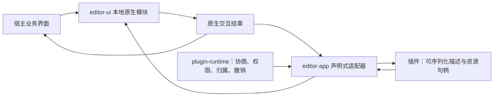
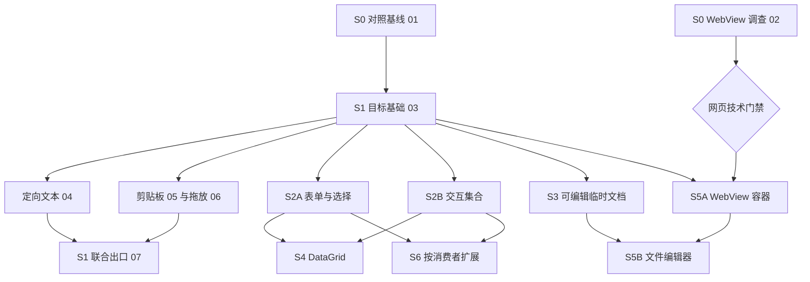

# 宿主与插件共享 UI 分阶段实施方案

日期：2026-10-25

状态：规划草案／待实施。本轮仅形成方案与索引，不修改 Rust 源码、Cargo 清单或锁文件，不创建实施议题，不提交或推送。

S0／S1 已补充[状态、事件、权限与错误细化规格](shared-ui-s0-s1.md)，并拆为[七张本地端到端工单](../tickets/shared-ui-foundation/README.md)。当前仅完成文档，所有调查、探针及功能均未由本方案实施；S0／S1 的具体契约与直接依赖以细化规格和本地工单为准。

## 1. 目标与约束

让设置、搜索、JSON 工具、数据库、翻译、图表及自定义文件编辑器通过通用接口组合界面。原生控件的绘制、输入、主题与交互集中在同一个本地实现，宿主和插件分别使用适合自己的调用方式。

- 保留 `gpui-kit` 正式入口，使用锁定的 GPUI 原语及 `gpui-base`；不 fork，不升级既有依赖，不引入 `gpui-component` 及其宏库。
- 本地通用模块放在 `crates/editor-ui/src/<模块名>/mod.rs`；辅助实现、状态和测试放在同一目录。优先复用 Base 的公开行为接口，不复制上游整套实现。
- 沿用现有 crate 职责，不为每类控件新建 crate，不新增只转发调用的共享层。
- 插件业务、数据库查询、格式化、翻译及白板策略留在插件；宿主提供所有插件都能协商的通用机制，不按插件 ID 设置业务分支。
- 文档文本、选择、IME 与会话 Undo/Redo 由宿主管理；新增临时文档也各自拥有唯一原生会话，不产生同一文档的第二份可变文本或撤销栈。
- 当前用户已明确将 WebView 用于插件视图及 Excalidraw 文件编辑器。本方案仅为该范围规划 WebView 接入；实施 S0 时同步核对历史“界面不使用 WebView”条款与现行规格的表述，其他原生界面继续遵循既有基座。
- 本轮不新增依赖。实施 WebView 前须证明固定版本绑定、运行时和平台接入方案可行；新增依赖与升级既有依赖分别审查，不把“已有 Windows COM 支持”当作已具备 WebView。
- 当前工作区存在其他任务改动。源码中的在途实现用于确定接续位置，不代表已通过验收或已发布。

依据：[通用插件平台方案](plugin-api-platform.md)、[文件显示与中心布局方案](plugin-ui-decoupling.md)、[仓库约定](../../../AGENTS.md)。

## 2. 当前基线与真实缺口

以下是 2026-10-25 本地源码核对结果，实施前需再次核对最新快照。

| 领域 | 已有基础 | 本方案接续内容 |
| --- | --- | --- |
| 原生控件 | 按钮、输入、多行输入、复选框、单选组、标签、滚动、分栏等 | 更完整的选择与字段模块；检查已有插件呈现路径是否使用同一本地外观实现 |
| 浮层与组织 | 对话框、菜单、工具提示、停靠、资源树、标签重排 | 通用组合、焦点恢复及公共命令接入；不重建整套布局系统 |
| 编辑视图 | 已是 `Kind::Editor(Editor)`，以 `Document`／`Snapshot` 区分来源，支持只读、行边缘控件及同步配置 | 宿主管理的可编辑临时文档、多窗格的明确资源绑定；不再次安排“三种编辑器合并” |
| 虚拟文档 | `OpenVirtualDocument`／`OpenVirtualSource` 提供只读内容 | 保留只读含义，另行扩展可编辑会话；不通过改 `read_only` 给快照授予写入能力 |
| 集合 | 树已有懒分页、结构更新、三态勾选及菜单；`SideTabs` 已有选择和排序 | 通用交互式虚拟列表、可编辑网格；复用可共享算法与行为经验 |
| 数据展示 | `List`／`Table` 为只读文本展示 | 稳定行键、结构化列、选择、分页、单元格编辑与提交 |
| 图形与文字 | 已有 Canvas、可视视口、图片、文字测量及本地 `text_grid` | 按真实消费者组合图表、属性编辑等；不重新建设字符网格或重复现有画布能力 |
| 文件与文档 | 文件显示提供者、版本化编辑及保存、工作区文件操作已有基础 | 临时文档生命周期与 WebView 文件编辑器会话；现有 `WillSave` 仅供观察，不能作为保存拦截点 |
| 跨区域交互 | 各控件、文档及图片已有局部输入与选择机制 | 通用文本目标、命令路由、受控拖放、统一异步状态及资源清理 |
| 网页视图 | 当前协议无 WebView 节点，清单未见现成承载绑定 | 先做依赖与原生嵌入可行性核对，再建设通用容器及文件编辑接入 |

核对入口：

- [本地控件入口](../../../crates/editor-ui/src/lib.rs)
- [插件 UI 描述与现行编辑器节点](../../../crates/plugin-protocol/src/ui.rs)；统一 Editor 迁移仍在独立任务中验证，本路线图不将其视为已经合入的能力。
- [文档接口与事件语义](../../../crates/plugin-protocol/src/api/documents.rs)、[树契约](../../../crates/plugin-protocol/src/tree.rs)
- [插件呈现适配器](../../../crates/editor-app/src/ui/plugin/containers.rs)

## 3. 共用一套实现的方式

### 3.1 两种调用方式，共用本地模块



这是调用职责图，不要求重排现有 Cargo 依赖。`editor-ui` 隐藏焦点、IME、草稿、滚动、布局、绘制、主题和无障碍语义等复杂性；共享模块不管理工作区与插件实例业务。

| 位置 | 职责 |
| --- | --- |
| `editor-ui` | 小型本地接口及完整原生行为；宿主与插件适配器构造同一种本地控件 |
| `plugin-protocol` | 可序列化描述、类型化事件、资源引用、不变量、能力与错误契约；不暴露 GPUI 对象或 Rust 闭包 |
| `plugin-runtime` | 能力协商、权限、实例与资源归属、配额、异步请求及撤销；不承接界面绘制 |
| `editor-app` | 将描述适配成本地模块，将交互转换成公开事件；连接真实文档、命令与文件生命周期 |
| 插件 | 领域数据、校验和操作策略、布局组合、业务请求及结果处理 |

例如宿主设置页直接调用本地选择控件；插件发布选择节点，由适配器创建同一个控件。键盘导航、搜索草稿、弹层和 IME 在原生侧处理，业务选择结果交给各自调用方。宿主不必先把自己的界面序列化为插件协议。

WebView 的共享范围是容器、消息、资源与文件会话接入；网页内部 HTML/JavaScript 控件由插件提供。它们不会自动变成 GPUI 控件的同一份绘制实现。原生模块与网页视图共用可适用的主题、命令及文档语义。

### 3.2 接口方案比较与选择

| 候选 | 接口组织 | 深度与局部性 | 代价 |
| --- | --- | --- | --- |
| A：精简公共入口 | 复用视图发布、资源操作、资源释放三个既有入口族 | 接缝稳定，不增加共享 UI 引擎；复杂交互集中在本地模块 | 描述与本地类型仍需适配与一致性验证 |
| B：组合资源模型 | 声明树结合分类型集合、文档、网页资源和版本化事件 | 网格、树表与属性面板可复用数据接入机制 | 资源与单元格模板若过度泛化，会扩大接口 |
| C：常见场景默认接口 | 字段、集合、编辑视图、自定义文件视图各自提供少配置默认值 | 日常调用简单，复杂行为留在模块内部 | 各模块若重复维护目标、版本和清理规则，会发生分歧 |

采用 A 的现有接缝，以 B 支持有真实需求的资源，并采用 C 的默认行为。S0／S1 的语义和待实现能力名由细化规格确定，其他阶段在各自实施前冻结；不预建通用表达式、任意数据绑定语言或第二套 UI 引擎。

### 3.3 状态与异步不变量

- 用实例 incarnation、稳定节点 ID、目标身份及对应版本识别操作；集合使用稳定行键和列 ID，不使用数组下标承担身份。
- 控件草稿与已提交领域数据分开；普通回显不覆盖正在进行的输入或中文组合。显式重置、外部更新与提交确认有可区分的语义。
- 文档 revision、UI revision、集合数据版本和文件版本各司其职；跟随焦点不能替代精确目标校验。
- 先建立资源与事件接入，再挂载视图；替换或关闭时先使回调失效，再清理订阅和资源。迟到结果不得重新激活目标。
- 高频滚动、指针捕获与输入响应留在原生帧内；插件处理经过定义的业务事件，不逐像素往返 WASM。
- 布局与显示授权不自动授予文本、文件、剪贴板或网络访问。沿用既有错误分类，并在新契约中明确过期、关闭、拒绝和超限的含义。

## 4. 阶段、优先级与依赖

P0 为后续功能依赖的基础及高复用交付；P1 为高价值复杂能力；P2 为可在基础稳定后按真实消费者扩展的能力。阶段号表示组织顺序，不表示必须全部串行。当前各实施阶段均未由本方案执行。

| 阶段 | 优先级 | 交付内容 | 必需前置 | 阶段出口 |
| --- | --- | --- | --- | --- |
| S0 基线与契约清单 | P0 | 01 对照共享基线；02 独立核对 WebView 可行性 | 无；两项调查互不阻塞 | 分别记录调查完成和技术门禁，不能把源码存在写成验收通过 |
| S1 公共交互基础 | P0 | 03 目标／焦点／命令；04 定向文本；05 剪贴板；06 拖放；07 在途交互撤销联合出口 | 03 依赖 01，其他直接依赖见工单；不等待 02 | 三类目标贯通，状态／事件／授权／错误一致；07 完成才宣称整体基线完成 |
| S2A 选择与表单 | P0 | Select／ComboBox／多选、Switch、数字字段、字段标签与校验、统一草稿和提交；补齐已有控件的本地呈现路径 | S1 目标基础 03；通用文本工具另需 04 | 一个宿主界面与一个插件消费者使用同一实现；焦点、IME、校验及回显一致 |
| S2B 通用交互集合 | P0 | VirtualList／ListBox、自定义行组合、多选、内联编辑、分页、加载／错误／取消、稳定选择与滚动 | S1 目标基础 03；按涉及的交互满足对应工单 | 大集合只创建可见区及有界预取；筛选、分页及刷新保留正确身份 |
| S3 可编辑临时文档 | P0 | 宿主管理的可编辑临时会话，接入统一 Editor；明确多窗格绑定、保存／另存为及退役保留 | S1 目标基础 03；通用文本工具另需 04 | JSON 输入与输出均可编辑，保持各自原生状态；过期格式化结果不能覆盖新输入 |
| S4 可编辑数据网格 | P1 | 平面 DataGrid：结构化列、选择、复制粘贴、列操作、虚拟化、单元格编辑与确认 | S2A、S2B；完整复制粘贴另需 05 | 数据库／CSV 场景贯通；导航与编辑模式、失败保留和迟到数据可观察 |
| S5A 通用 WebView 容器 | P1；技术核对前置到 S0 | Windows 原生承载、受控本地资源、消息、主题、尺寸、焦点、销毁和失败呈现 | 03 与 02 的技术门禁通过；不等待 DataGrid | ECharts 普通视图可通过通用接口运行；无需接入自定义文件保存 |
| S5B WebView 文件编辑器 | P1 | 在现有文件提供者上接入通用文件编辑会话、序列化、保存、关闭与资源管理器联动 | S5A、S3 的文档生命周期 | Excalidraw 的打开、编辑、保存、另存为、重命名、外部修改及关闭完整贯通 |
| S6 扩展输入与组合 | P2 | 日期／时间／范围／颜色，工具栏、属性面板、空状态，TreeGrid、富文本编辑及可复用图表组合 | 按下文分支依赖 | 由实际消费者证明可复用；宿主机制与插件业务职责保持分离 |



S1 的 04／05／06 共同依赖 03，互相没有硬依赖；02 的可行性结论不阻塞原生 S1。目标基础稳定后可分别准备 S2A、S2B、S3，涉及哪些公共交互就满足相应工单；不能把未完成切片当作已支持能力，07 是整体共享交互基线的联合出口。

WebView 与 DataGrid 没有相互前置关系。搜索型选择的远程分页增强等待 S2B；DataGrid 的普通单元格复用字段模块，不必等待 S3，代码型单元格再依赖 S3。

S6 的具体依赖为：日期／颜色及属性面板依赖 S2A；TreeGrid 依赖已有 Tree 加 S4；原生富文本编辑依赖 S1、S3 的输入与文档机制，网页方案依赖 S5；图表可复用现有 Canvas 或 S5A。每个分支独立验收，不等待所有 S6 子项齐备。

## 5. 各阶段的关键实施范围

### S0：先固定基线与可行性

本阶段以工单 01／02 独立交付，状态与门禁规则见细化规格 D02；当前尚未执行调查或探针。

1. 记录当前源码快照、清单与锁文件版本；列出“已有、在途、需增强、新增”四种状态，并核对相关验收记录。
2. 盘点宿主与插件适配器调用本地模块的差异；已有 Base 行为继续复用，本地外观与交互统一后再拓展新节点。
3. 列出新增契约、权限、资源寿命、错误及 SDK 消费者；能力名和版本为阶段设计结果，不在本方案假定已经注册。
4. WebView 技术核对独立进行：现有平台绑定和窗口接缝、固定版本绑定需求、运行时来源、许可证及分发方式；不升级既有依赖、不 fork、不静默安装运行时。
5. 实施技术探针时证明嵌入、尺寸／DPI、焦点与 IME、GPUI 浮层叠放／裁剪、消息和销毁。若锁定条件下不能满足，明确该分支的具体缺口；原生阶段仍可独立交付。本轮不编写或运行探针。

### S1：公共交互先落在真实目标上

按工单 03–07 逐条交付。状态转换、事件因果、权限、错误和范围以细化规格 D03–D10 为准；以下为路线图摘要。

- 文本目标描述目标身份、版本、可读区域、选区和可编辑性；发起翻译时固定目标，异步回复不重新取“当前焦点”。
- 编辑器目标接入原生文档会话；输入字段接入现有原生输入状态；只读弹窗目标只允许读取及呈现结果。密码等敏感区域不导出；授权按用户动作、目标和权限校验，不开放任意扫描界面文本。
- 复制、粘贴、全选、撤销、保存等按目标能力路由；弹窗关闭后恢复有效焦点。并非所有目标都必须支持全部命令。
- 拖放使用文件或类型化数据及受控资源句柄；跨资源、实例、WebView 的交付各自检查归属和操作范围。
- 订阅及临时目标在关闭、替换、信任撤销和实例退役后失效；错误不会悄悄改写其他目标。

### S2A／S2B：字段与集合共用原生交互

- 字段支持值、占位、禁用／只读、说明、校验结果及提交状态。异步校验携带目标和草稿版本，过期结果不能覆盖新输入。
- 选择控件先交付有界本地选项；异步搜索及分页复用 S2B 的数据版本、取消与加载机制。
- 集合统一稳定键、选择、激活、分页与可见区；单击选择、双击或键盘激活等行为有明确契约。
- 自定义行及单元格只允许有界原生节点组合与事件，不向插件交出任意原生绘制闭包。
- 无障碍语义、键盘、中文 IME、主题、字号与缩放随每个模块同时交付，不留到最终阶段补做。

### S3：可编辑会话延续统一 Editor

- 新建宿主管理的临时文本会话，返回可校验身份与版本；统一 Editor 仍以明确来源引用会话。
- 明确普通文件、临时会话和只读快照的能力差异。快照保持不可编辑，临时会话是否具备语言能力按单独协商与已有提供者选择规则执行。
- 多窗格可以引用不同会话；必须显式扩展现有单一来源布局的验证规则，不能绕过 `Document.source` 校验强塞第二个编辑器。
- 格式化和翻译使用预期版本的原子编辑；输入、选择、IME、Undo/Redo 和保存继续进入宿主原生路径。
- 临时会话用户修改后，关闭或插件退役需执行明确的保留流程，例如另存为、宿主继续托管或用户选择放弃；不因实例清理静默丢弃文本。

### S4：DataGrid 先交付平面编辑

- 数据来源提供稳定行键、列描述、数据版本、分页结果及可编辑性；SQL、查询计划、联网与数据库事务留在插件。
- 原生模块负责虚拟化、单元格与区域选择、键盘导航、编辑态切换、IME、列宽和列顺序。
- 编辑提案包含行键、列 ID、原数据版本及新值；插件返回接受或业务校验错误。拒绝或超时应保留可恢复的输入，不能假报提交成功。
- 排序、筛选与分页更新不能将选中行或正在编辑的单元格错误地绑定到新数组位置。
- 初期复制粘贴以有界文本／表格数据为目标。批量粘贴明确原子性或逐项结果；网格本地撤销不承诺回滚已完成的外部数据库副作用。
- TreeGrid、冻结列、复杂分组和代码型单元格按真实需求后续扩展，避免把所有复杂性压入首个交付。

### S5：通用网页呈现与文件生命周期分开交付

- S5A 先支持插件包本地页面、受控资源与类型化消息；网络、下载、剪贴板、文件访问分别遵守既有授权，不以 WebView 身份继承宿主环境能力。
- 同一个容器可服务宿主调用方和插件；插件页面不能直接访问工作区文件或原生对象。页面重载及进程失败必须使旧会话消息失效。
- S5B 为文本格式优先复用宿主 `DocumentSession`：网页编辑表现同步成版本化文档变更，场景与视口状态分开，避免选择和缩放动作误标记内容修改。
- `Ctrl+S`、菜单保存与页面保存按钮进入同一保存请求路径。保存确认只确认真正写入的版本，期间发生的新修改继续保持未保存状态；`WillSave` 观察事件不承担拦截职责。
- 已接受内容的保存不能依赖页面正处于可见状态。后台标签、页面重载或崩溃时，宿主仍能保存已接受的版本；尚未同步到宿主的内容有明确的失败或恢复语义，不将旧内容误报为全部保存成功。
- Undo/Redo 采用单一协调者。网页提交场景变化或快照，适配器将其转换为宿主版本化且可撤销的文档变更，网页作为投影接收结果；不预设原版编辑器直接提供可逆命令。须先验证其内部历史能否关闭或正确协调，不能同时维护两套互不知情的权威撤销栈；此项纳入前置可行性核对。
- 文件打开、另存为、重命名、移动、外部修改和关闭沿用通用文件提供者与资源管理器流程；文件操作成功后再更新绑定与可见状态。
- 首个文件编辑场景以 `.excalidraw` 文本场景为验收对象；二进制可编辑格式需要另行明确提供者的文档与历史契约，不强制创建文本 Rope。

## 6. 验收与迁移

### 6.1 每个阶段的共同出口

1. 契约、能力协商、权限、错误、资源释放和 SDK 使用说明与实现同批交付；公开接口说明维护在协议源码注释中。
2. 至少一个宿主真实调用方，以及一个经公开管理器进入宿主的插件消费者，使用同一个本地实现完成相同关键行为；不以两个独立实现外观相似作为共享完成依据。
3. 控件行为测试靠近组件；宿主集成测试覆盖版本与生命周期；固定插件夹具保留版本／摘要账本，不恢复随附插件源码或新增特定插件测试专用入口。
4. 检查节点更新不丢失 IME、焦点、选区与未提交草稿；关闭、禁用、更新、信任撤销后资源清理，迟到回复被拒绝。
5. 验证深浅主题、中英文、字号缩放、键盘、真实中文 IME、滚动、DPI 和无障碍语义；WebView 另验原生叠放、焦点转移与崩溃恢复。
6. 各阶段只迁移相关消费者，扩展优先独立协商；破坏性契约使用明确的新主版本并同步消费者，不新增旧协议运行兼容分支，保留用户数据和设置。

### 6.2 五个端到端场景

| 场景 | 必须观察的结果 |
| --- | --- |
| JSON 工具 | 输入／输出各自可编辑；过期格式化不覆盖新内容；原生 Undo、中文 IME、另存为和关闭保留有效 |
| 翻译 | 编辑器、普通输入框、只读定义弹窗均可取得适当目标；焦点转移不改变原目标；只读结果仅呈现，敏感字段不导出 |
| 数据库／CSV | 大集合虚拟化，选择和排序身份正确；编辑／粘贴有明确确认与失败结果；插件独立处理查询和提交 |
| ECharts 类视图 | 通用 WebView 加载本地页面，尺寸、主题、消息及销毁正确；不需要为图表名称新增宿主分支 |
| Excalidraw 文件编辑器 | 资源树打开、网页编辑、宿主及页面保存、另存为、重命名、外部更改、关闭未保存内容与恢复均进入通用会话路径；后台、重载或崩溃时保存语义明确 |

性能验收先以 S0 的可复现夹具和机器环境建立基线。S2B 至少准备一万项记录，S4 准备十万行、二十列的分页数据源；数据量为建议验收输入，正式预算在实现前冻结。证明原生实例数、驻留数据与网络／WASM 请求有界，不在每次输入、滚动时全量构建数据集；分别记录首次加载、滚动、输入和峰值内存，不预先声称固定帧率。

### 6.3 实施时的检查入口

每个实现阶段先运行受影响模块测试，再执行：

```powershell
cargo fmt --check
cargo test --workspace --exclude editor-app
cargo check --workspace
```

修改宿主时补相关 `cargo test -p editor-app <过滤词>` 与原生验收；实际 WASM 包测试按对应验证文档准备夹具后显式执行相关 ignored 测试。检查依赖树与锁文件不含 `gpui-component` 及其宏库，既有依赖版本不升级。

使用公共模块接口测试可观察行为；同一行为被完整替代后清理冗余测试，保留独立风险的生命周期与原生交互覆盖。失败分别记录本阶段缺陷、既有问题和环境缺失，不把 ignored 或编译成功当作行为验收。

本轮只有文档变更，检查相对链接、阶段依赖和 `git diff --check`；未执行本节 Rust 检查，不宣称上述功能已实现。

## 7. 外部参考与适用范围

- [W3C Grid 交互模式](https://www.w3.org/WAI/ARIA/apg/patterns/grid/)：用于参考复合网格的焦点导航及进入单元格编辑的交互。网页 ARIA 属性不直接替代原生无障碍实现。
- [VS Code 自定义编辑器](https://code.visualstudio.com/api/extension-guides/custom-editors)：参考视图与文档模型分离、修改事件、保存和撤销协调，不复刻其全部平台。
- [Microsoft WebView2 能力总览](https://learn.microsoft.com/en-us/microsoft-edge/webview2/concepts/overview-features-apis)：用于后续核对 Windows 承载、消息、焦点、尺寸及 Composition 接入；文档存在不能证明当前绑定版本或 GPUI 窗口接缝已经满足要求。

## 8. 本轮交付状态

已形成阶段划分、依赖、共享实现策略和验收要求；所有新增能力待实施。未修改源码与依赖、未执行功能测试、未创建或关闭议题、未提交或推送。后续实施应以每阶段自己的验证记录更新状态。
