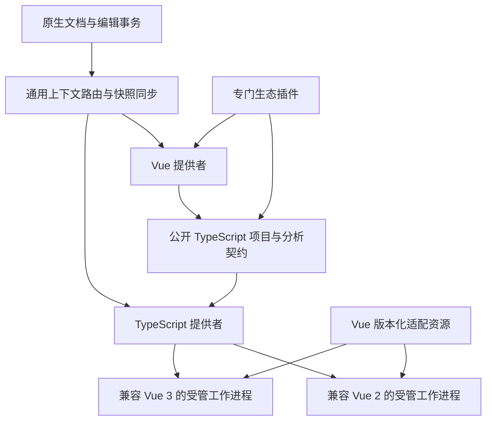

# Vue 多版本插件与 TypeScript 协作方案

日期：2026-10-15。

状态：产品范围与协作方式已通过访谈确认，用户已要求开始实施；以下接口尚待落地。已启动[工具层协作探针](../verification/vue-typescript-p0-2026-10-15.md)，[11 张实施切片草案](../tickets/vue-typescript/README.md)待拆分确认；未发布实施议题或完成正式插件、宿主与原生验收。本文不继承既有插件平台工单的完成状态；后续执行沿用仓库对用户要求实施工单的既有授权。

目标：用户安装一个 Vue 插件，由插件选择兼容后端，首批完整支持 Vue 2.6、2.7、Vue 3 与混合仓库；历史版本逐步补齐并长期保留，未来版本经过适配和验收后加入。TypeScript 插件统一管理项目上下文和类型分析，Vue 通过公开接口协作。宿主只提供通用机制，不识别具体 Vue 版本或插件 ID。

## 1 已确认范围

| 事项 | 确认结果 |
| --- | --- |
| 包与发行 | 一个 Vue 插件；兼容后端是其内部版本化工具，不拆成用户必须分别安装的 Vue 2、Vue 3 插件 |
| 首批版本 | Vue 2.6、2.7、Vue 3；Vue 2.5 及更早版本、Vue 1.x、0.x 后续逐步补齐 |
| 支持标准 | 补全、诊断、悬浮、跳转、引用、重命名、格式化通过适用场景验收，才标为正式支持；仅高亮属于基础支持 |
| 项目与文件 | 同仓库 Vue 2/3 子项目；`.vue`、关联 JS/TS、合法的外部 `src` 块与跨文件引用；HTML/CDN 用法后续补齐 |
| 代码写法 | 对应版本的 Options API、Composition API、`script setup`、JS/TS；类组件、装饰器、JSX/TSX 和 Vue 2 Composition API 扩展均纳入首批兼容矩阵 |
| 模板与样式 | 首批标准模板、CSS、SCSS/Sass、Less；不能把目标 Vue 版本本身不支持的语法变成合法语法 |
| 其他生态 | Pug、Stylus、Nuxt 等专属能力由专门插件提供；Vue 提供公开协作接缝，不把这些功能规划为日后全部内置 |
| TypeScript | TypeScript 插件拥有引擎、版本选择、项目上下文与共享 JS/TS 文件的展示策略；Vue 不私自选择另一套 TS 引擎 |
| 协作方式 | 允许 TS 插件在受管独立分析进程中加载 Vue 提供的适配模块；不加载进 Nanobug 主程序，不声称模块间有 WASM 级隔离 |
| 工具准备 | 在已授权范围内按项目需要准备固定版本、固定摘要的私有工具；不改全局环境或项目依赖 |
| 不明确版本 | 证据充分时自动选择；证据不足或冲突时提示修复或显式指定，不能静默套用最新版本 |
| 长期维护 | 必要时维护历史后端分支或补充实现；新发行不得移除或降低已验收的历史能力 |

“覆盖全部版本”是长期产品方向，不代表未验收版本已经可用。首批发行须列出实际覆盖的 Vue、TS、适配模块及相关扩展版本范围；不能用少量代表样例替代整个范围的支持证据。未来版本也不因版本号更大而自动获得正式支持标记。

## 2 依据与当前能力

遵循[插件平台规格](plugin-api-platform.md)、[项目需求](../../project/需求整理.md)与[开发计划](../../project/开发计划.md)。后续扩展遵守能力协商、工作区信任、唯一编辑状态、提供者选择和事务清理规则。

下表是 2026-10-15 当前工作区的只读核查结果，包含原有未提交改动；并非新功能验收，也不是对某个干净发布版本的断言。

| 能力 | 当前实现 | 本方案的差额 |
| --- | --- | --- |
| 一个包声明多服务 | [Provider](../../../crates/plugin-protocol/src/language.rs) 有 `service`、`alternatives`、`hook` | 可复用候选声明；不能等同于按子项目同时运行多个后端 |
| 项目配置 | 同文件 `Context` 只有工作区等信息，`Proposal` 返回一个项目根与服务方案 | 新增文档到项目上下文的解析与多实例绑定 |
| 服务实例 | [应用路由](../../../crates/editor-app/src/app/language_servers.rs)与[需求归并](../../../crates/editor-app/src/app/language_servers/demands.rs)按语言管理；[运行时缓存](../../../crates/plugin-runtime/src/manager/language.rs)按 owner/provider 查找 | 实例与文档绑定必须包含上下文及配置代次 |
| 依赖准备 | [Artifact](../../../crates/plugin-protocol/src/dependencies.rs)锁定版本、平台与摘要；[缓存](../../../crates/plugin-runtime/src/dependencies/cache.rs)有私有目录、租约和回滚收据 | 安装时每个 provider 的计划及现有 `on_demand` 路径，不等于按文档需要准备任意 LSP 后端 |
| 未保存文档 | [文档接口](../../../crates/plugin-protocol/src/api/documents.rs)可读取精确 revision；事件只含元数据 | 新增宿主原生的关联文档同步，不依赖 WASM 逐次复制全量文档 |
| LSP 文档同步 | [启动](../../../crates/editor-app/src/language/navigation/startup.rs)与[快照同步](../../../crates/editor-app/src/language/navigation/snapshots.rs)固定使用 provider 的 language ID | 同一上下文的 Vue、JS、TS 文档须保留各自 language ID 与真实逻辑 URI |
| 插件协作 | [服务契约](../../../crates/plugin-protocol/src/service.rs)有版本化 RPC、取消与延迟回复；消息有 64 KiB 限制 | 不是完整文档流、跨插件代码导出或任意句柄转交接口 |
| 准备钩子 | [只读允许列表](../../../crates/plugin-runtime/src/instance/capability_calls.rs)不允许服务调用 | 跨插件协作放在异步准备阶段；不让现有只读钩子同步等待其他插件 |
| 多扩展组合 | [服务注册表](../../../crates/plugin-runtime/src/plugin_services/registry.rs)每契约选择一个提供者 | 单选服务与可组合扩展必须分别建模，不能把 Open 当广播 |
| 设置作用域 | [设置协议](../../../crates/plugin-protocol/src/settings.rs)提供用户/项目作用域与标量设置，没有原生嵌套的子项目映射表 | 上下文选择的本机持久化需要通用设计，不能假定新增一个数组设置就已有交互支持 |
| 跨文件重构 | [编辑结果转换](../../../crates/editor-app/src/language/navigation/editing.rs)当前拒绝其他文档的重命名编辑 | 新增完整源文件编辑计划及批量预览、冲突检查、分组撤销接入 |
| 生态高亮 | [Highlighter](../../../crates/plugin-schema/src/languages.rs)已有 grammar 注入 | 可复用高亮组合，但不等于已有预处理、类型分析和映射协作 |

历史[语言服务验收](../verification/plugin-api-lsp-verification.md)与[依赖验收](../verification/plugin-api-dependencies-verification.md)没有验证本方案的跨项目、多语言上下文和跨插件模块加载。核查时尚未发现可直接承担完整类型分析的现成 TypeScript 插件；[现有 JavaScript 插件](https://github.com/Nanobug-Editor/JavaScript/blob/main/manifest.json)仅提供相应语言的识别、高亮和格式化，不能作为已完成的 TS 基础能力。

## 3 职责与模块接缝

| 模块 | 拥有的策略与资源 | 对其他模块提供的接口 |
| --- | --- | --- |
| Nanobug | 权限、实例、受管依赖、源文档快照、通用上下文租约、请求路由、进程树、编辑事务 | 与语言无关的注册、解析调度、同步、调用、撤销和结果提交 |
| TypeScript 插件 | TS 项目发现、配置继承与引用、引擎版本政策、项目上下文、工作进程及 TS 分析结果 | 公开的项目上下文与类型分析契约；可协商的语言适配模块加载接口 |
| Vue 插件 | Vue 版本证据、SFC/模板语义、兼容表、Vue 语言服务、适配模块、Vue 映射与结果组合 | 一个公开 Vue 主分析提供者；消费 TS 契约，贡献版本化适配模块 |
| 专门插件 | 自身语法、预处理、框架发现与附加类型规则 | 声明扩展角色、输入输出语言、兼容范围与映射职责；自行管理必要工具 |

TypeScript 插件统一管理不等于只能运行一个进程。不同引擎、Vue 适配模块或配置组合可以使用不同工作进程，仍由同一个 TS 提供者统一管理。

宿主不得包含 `if vue2`、固定 TS 插件 ID 或 `_vue:*` 方法含义。协议名可以作为不透明的公共契约数据路由，但具体语义由提供和消费契约的插件解释。第三方实现相同契约、满足权限及兼容条件后可以被用户选用。

## 4 项目上下文与版本识别

### 4.1 统一上下文

TS 提供者先根据文档位置和项目配置解析候选上下文，独立于 Vue 模块的启动。宿主给通过校验的上下文签发租约，Vue 使用该租约而不是另建一套项目根、TS 配置或文件归属表。无显式 tsconfig/jsconfig 的 Vue 项目，也由 TS 提供者建立可解释的推断上下文。

上下文描述至少包含：拥有者实例、规范项目根、配置身份、配置代次、引擎兼容信息与可用特性。上下文 ID 不透明；路径和插件提交的普通字符串都不是访问授权。项目根保留在授权工作区内，符号链接与项目引用不能隐式扩大读取范围。

首批混合项目仍位于现有单根工作区内；本方案不增加多根工作区或多窗口产品范围。

进程复用条件包括 TS 引擎、适配模块集合及各自摘要、运行时、配置隔离能力；不能仅因为语言名称相同而复用。首批默认隔离互不兼容的 Vue 2/3 模块组合，不预设同一个 tsserver 能正确加载两套同名模块。

### 4.2 Vue 版本证据

Vue 插件在 TS 上下文范围内分析依赖声明、锁文件和实际安装的包信息，并记录证据来源。解析 package manager workspace、包别名和链接时按规范路径检查，不靠组件使用 Options API 或 Composition API 猜版本。

- 一致且足以定位兼容范围的证据可以自动选后端；只有宽泛依赖范围、无法确定的别名或互相矛盾的证据时进入待选择状态。
- 显式目标版本可以参与选择，但不修改项目依赖，也不掩盖实际安装与目标的差异。
- Vue 适配模块声明可接受的 TS 范围。TS 提供者负责选择和报告最终引擎；不兼容时返回结构化原因，Vue 不静默另起一套 TS 引擎。
- 早于首批范围、未知未来版本和已知但未验收组合均明确显示其状态，不落入“最新版应该兼容”的兜底。

### 4.3 共享文件

JS/TS 文件的主提供者和展示上下文由 TypeScript 插件统一管理，Vue 安装不能覆盖已有有效选择。Vue 请求始终携带所属上下文；同一个共享文件可作为多个上下文的分析输入，但只将当前主提供者、当前选定上下文的结果提交给该文件的编辑界面。

Vue 模板中引用共享类型时使用该组件所属上下文的分析。跨上下文结果不混合；切换上下文时取消旧请求并撤销旧诊断。文件有多个合法项目归属时，具体展示规则由 TS 插件提供，并通过通用宿主选择与本机持久化接口实现。

## 5 公开接口草案

下列名称是设计名，不是当前 SDK 已存在的 API；正式能力 ID、版本号和 JSON/WIT 编码在实现工单中核对。公开契约以源码注释和协议资源交付，本文不随 SDK 导出。

### 5.1 通用宿主能力

| 接口职责 | 关键输入与结果 | 必须维持的不变量 |
| --- | --- | --- |
| 上下文发布与解析调度 | 提供者发布候选根、配置身份/代次；宿主按文档调度，签发上下文引用 | 领域发现由插件执行；宿主只校验归属与作用域；主提供者选择不被覆盖 |
| 上下文语言绑定 | 文档、主分析/格式化角色、上下文引用、已声明服务方案 | 一文档一个主分析提供者；附属同步不授予诊断发布权；同语言可有多个项目实例 |
| 关联文档订阅 | 上下文引用、获准的文档集合/选择规则、快照版本 | 支持辅助输入与增量变化；逐文档 language ID；不得读取未授权路径 |
| 依赖准备任务 | 当前包授权的服务计划、上下文代次、取消信号 | 在钩子外下载；去重准备；取消、撤权后不得发布失效计划 |
| 不可变适配资源导出 | 包内或已验证依赖中的资源 ID、摘要、入口、ABI、目标运行环境 | 宿主签发接收方绑定的只读租约；不能借用其他插件私有句柄或任意路径 |
| 扩展发现与组合 | 已声明角色、兼容范围、顺序约束、所需授权 | 单选提供者与可组合扩展区分；冲突显式报告；不按安装顺序覆盖 |
| 有界上下文消息通道 | 双方已声明的协议、关联请求、上下文引用、截止时间 | 面向受管工作进程，不开放任意 socket；路由不解释 Vue 专属方法；取消与双方生命周期绑定 |
| 上下文失效 | 配置代次变化、包/依赖/权限/扩展变化及原因 | 只重新准备受影响上下文；结果带代次；文件事件丢失时重新扫描 |
| 源文件编辑计划 | 已映射的源 URI、预期版本、编辑范围及操作 | 全计划验证与预览；任一目标冲突则拒绝；统一 DocumentSession 和分组 Undo |

原生上下文消息通道是现有插件 RPC 的补充，用于有界异步分析通信，不应通过放大普通 RPC 限额承载所有文档。公开契约须明确最大帧、并发请求数、积压预算、超时、背压和取消；参数不得比既有传输约束更宽而无证据。大结果分页或使用宿主签发的只读快照/结果引用，不允许裸路径绕开额度。

### 5.2 TypeScript 插件的公共契约

建议使用版本化 `typescript.project`、`typescript.analysis` 与 `typescript.adapter` 契约族。这些是插件之间公开的领域接口，宿主仅匹配契约与授权，不内置其业务。具体方法以少量稳定接口封装发现、协商、运行和撤销，避免调用方管理 TS 内部对象。

| 操作 | 输入 | 结果与责任 |
| --- | --- | --- |
| ResolveContext | 文档身份、可选来源上下文 | 返回已登记的上下文引用、候选项或无法解析原因；Vue 不接管解析规则 |
| DescribeContext | 上下文引用 | 引擎版本、配置代次、特性、适配 ABI/兼容范围；不暴露 tsserver 私有句柄 |
| AttachAdapter | 上下文引用、宿主签发的适配资源租约、配置数据 | TS 协商并准备对应工作进程；返回绑定引用或版本/权限错误 |
| Analyze | 绑定引用、方法族、源文档/映射版本、位置与请求参数 | 提供有界结果或结果引用；携带完整版本封印；支持取消和延迟回复 |
| Release | 绑定引用 | 释放消费关系；最后引用消失时退休相应工作进程与导出资源租约 |

生命周期失效由宿主强制执行，不能依赖插件正常调用 Release。TS 引擎版本选择由 TS 提供者的设置与契约决定；Vue 只声明兼容条件，不覆盖该策略。

所有失败至少包含失败阶段、受影响上下文和可恢复方式。错误族区分提供者缺失/冲突、上下文不明确/已失效、兼容组合不支持、依赖未准备/校验失败、权限拒绝、请求取消/超时、源快照过期和编辑映射不完整。正式编码优先复用现有错误分类并补充结构化原因，不以无法解释的 `null` 结果代替失败。

### 5.3 Vue 与 TS 的原生协作

采用用户已接受的受管适配模块方式。Vue 提供不可变适配资源和兼容描述；TS 提供者在自己管理的独立工作进程中加载它，并管理 tsserver、项目、配置及类型分析。Vue 语言服务处理 SFC/模板特性，并通过有界通道请求对应 TS 上下文。

官方当前实现包含 TS 进程内插件和 Vue 专属请求处理，不是普通 TS LSP 加两份数据即可替代。`tsserver/request` 等上游协议由插件侧适配器转换为已协商的消息；宿主不增加 Vue 专属转发分支。Vue 2 的历史后端必须逐版验证，不从当前官方实现反推所有历史版本均使用相同结构。

适配模块与引擎在同一原生进程中运行，具有该进程的实际操作系统访问能力；此方式不提供跨模块沙箱。授权界面须显示提供者、加载用途与运行方式。WASM 的宿主能力仍逐跳校验，不因为导出模块而授予另一个插件全局宿主权限。模块仅进入经授权的工作进程，不进入 GPUI 主程序。

资源导出只允许声明的不可变资产，不暴露私有数据目录。宿主绑定导出者、接收者、scope、包版本、摘要、入口和 ABI；导出租约不能转送第三个插件。升级、卸载或撤权时先终止使用旧模块的工作进程及其受管子进程，再释放租约；删文件或撤销路径不能被当作卸载运行中代码。

## 6 准备与运行时序

1. 宿主识别文件，解析用户已选的 Vue 与 TS 契约提供者。缺少 TS 提供者时展示缺失依赖与可选安装/选择入口；用户未授权安装前不自动装插件，不宣称完整语言支持。
2. 在受信任工作区中，TS 提供者解析并登记上下文。此步骤不要求 Vue 适配器已经运行，从而避免 TS 等 Vue、Vue 又等 TS 的启动循环。
3. Vue 在该上下文中确定目标版本，查询 TS 提供者的能力与引擎信息，生成兼容计划。生态扩展通过独立异步协作阶段汇集。
4. 宿主按双方已获授权的依赖计划准备工具，校验版本与摘要，申请适配资源租约。状态区分下载、准备、启动和索引；同一不可变产物可去重，使用关系分别计数。
5. TS 提供者为最终兼容组合启动或复用合适工作进程，加载适配模块；Vue 服务连接对应分析通道。现有只读语言 hook 仅消费已准备的描述，不在其内部调用插件服务、下载或启动进程。
6. 宿主建立主文档与关联文档同步，完成所需快照水位后将该上下文标记就绪。依赖未同步完成时不发布看似完整的诊断。
7. 正常请求携带文档 revision、上下文代次、双方实例身份、服务代次及映射版本。只有全部仍有效的结果可以提交给当前文档。

设置、tsconfig/jsconfig、package.json、锁文件、实际工具版本或生态扩展变化时，先计算受影响上下文并递增代次，再重新准备。用户修改了项目事实后，旧结果不能继续伪装成当前结果；保留可恢复的旧工具不等于继续发布旧诊断。

更新插件时先准备候选兼容组合，再切换绑定；准备失败保留原有可用组合，激活失败恢复旧包/受管数据和可重新启动的旧组合。这里复用各包安装事务并验证上下文绑定，不声称已有跨多个插件包的原子安装事务，也不保证恢复原进程内存。

## 7 文档快照与位置映射

`EditorState` 和 `DocumentSession` 仍是唯一可变原文与 Undo/Redo 来源。TS/Vue 后端可以持有从 revision 派生的分析缓存、虚拟代码和位置映射，但不能把它们变成另一份可写文档真相或直接写回磁盘。

主分析与辅助输入分别授权。例如 `.ts` 的主提供者为 TS，Vue 上下文仍能获得它的未保存快照作为依赖；辅助接收不允许向该文件额外发布一套诊断。宿主保存 `(上下文, 文档实例, revision)` 的同步水位，跨 Vue/TS 服务的请求引用相同水位。

原生同步不能建立在“ListDocuments 不超过 128 个”或“每次全量 RPC 文本不超过 64 KiB”的假设上。使用受控订阅、增量同步及有界完整快照重同步；事件丢失、关闭重开或进程重启时先重建水位。大文件不得静默截断分析后仍宣称完整结果。

Vue 适配模块拥有 SFC 与虚拟代码之间的映射，记录源 URI、revision、生成代次、范围及各特性是否允许映射。UTF-8/UTF-16、中文 IME、CRLF、组合字符与外部 `src` 块都需要验证。生成代码中的帮助符号、不可逆范围和过期映射不得成为用户编辑目标。

现代服务可能依赖稳定文件 URI 进行模块解析。现有诊断快照 URI 策略是否适用于选定后端必须实测：不能仅用变换 URI 解决旧诊断，却破坏导入和 tsconfig 解析。若必须保持稳定 URI，则通过服务适配层携带文档版本/分析代次、取消与结果封印拒绝旧诊断；无法证明结果属于当前快照时丢弃结果。

## 8 特性与跨文件编辑

| 特性 | Vue 与 TS 的协作 | 宿主提交规则 |
| --- | --- | --- |
| 补全与自动导入 | Vue 模板/组件规则结合 TS 类型结果；映射回源范围，附加导入一起返回 | 同一版本检查；主编辑及附加编辑作为一个计划，不能只执行一部分 |
| 诊断与悬浮 | 区分 Vue 语法/模板诊断与 TS 类型结果，保留来源并映射 | 校验文档和上下文；同一语义来源避免重复发布 |
| 跳转与引用 | 请求当前上下文；允许跨 `.vue`、JS/TS 与合法外部块 | 路径与读取授权校验；虚拟 URI 必须转换为真实可定位源位置 |
| 符号重命名 | TS/Vue 生成完整跨文件结果并映射；无法映射的必要编辑使整个请求失败 | 统一预览、版本冲突检查、事务提交与分组 Undo；不直接保存原本未保存的文件 |
| 格式化 | Vue 组织 SFC 各块；按已选提供者/公开契约获取相应格式化结果 | 保留现有独立格式化选择；受影响范围及文档版本一致；不隐式升级项目格式化依赖 |

首批“重命名”指符号及跨组件引用重命名，不自动扩大为重命名磁盘文件、移动目录或运行任意 LSP command。后端返回不支持的资源操作时整项拒绝并说明，不执行可识别的前半部分。

跨文件编辑需通过通用文件事务和原生文档接缝处理已打开脏文件、未打开文件、只读文件和冲突。源分析上下文内所有相关未保存 revision 也属于前置条件；目标未变化不代表源分析仍有效。任何路径越界、重叠编辑、目标关闭重开或来源失效都必须阻止整个计划。

## 9 专门插件的组合

Pug/Stylus/Nuxt 等通过公开扩展角色参与，不在 Vue 或宿主中按其插件 ID 写条件。角色至少区分模板转换、样式处理、项目配置贡献和类型适配；一种语言可有竞争提供者，多种独立角色可以组合。

- 高亮沿用已选 grammar 的注入能力；缺失 grammar 时明确该块能力不足，不因此执行额外工具。
- 预处理结果须携带来源快照与位置映射，Vue 将映射组合到 SFC 层；只有高亮不等于具备预处理语义。
- 框架扩展提交结构化配置/类型贡献，不直接改用户 tsconfig。冲突设置、扩展执行顺序及不兼容 ABI 显式失败，不按安装顺序覆盖。
- 需要在 TS 工作进程内执行的扩展走同一不可变资源导出与加载授权；只提供数据的扩展可复用有界版本化 RPC。
- 缺少专门插件时保留其他可用特性，并标明受影响块/框架能力，不把该生态组合计为正式支持；安装专门插件仍走用户授权。

首批交付组合契约及至少一个宿主从未认识的测试扩展，验证新增/替换/移除不需要修改宿主和 Vue 核心路由。Pug、Stylus、Nuxt 的正式业务实现属于各自后续插件任务，不被该测试替代。

## 10 兼容表与工具分发

每条兼容记录包括 Vue 范围、写法/生态组合、Vue 服务版本、适配模块版本与 ABI、可接受 TS 范围、运行时范围、平台、产物摘要、已验收特性及已知限制。记录随 Vue 插件版本发布，TS 提供者通过契约协商，不靠共享一份可随意修改的全局配置。

可先调查 Vue Language Tools 的 3.0.x 作为 Vue 2 候选，按 Vue 3 目标选择现行候选；这些只是评估输入，具体 patch、Node/TS 组合和类组件能力须在原型后锁定。语言工具版本不等于 Vue 框架版本，不能用 `Vue 2 -> 工具 2.x` 之类机械规则。

Vue 工具由 Vue 包声明，TS 引擎与 TS 运行策略归 TS 提供者；底层相同不可变产物可以缓存去重。发布预构建、锁定传递依赖的 ZIP 或同等可验证产物，优先避免在用户机器运行浮动 npm 安装。安装脚本如确有必要，仍按现有契约单独授权。

按需准备只能取得当前已授权包版本声明的兼容计划，不能以“缺少后端”为由静默升级插件、采用在线最新版本或安装整个项目 SDK。离线缓存可复用；缺失时明确等待或提供受校验的离线来源。

包更新对受影响组合重新协商。若 TS 新版本不能运行某个已支持的 Vue 适配模块，应保留可选择的既有兼容组合或明确阻止该切换，不把历史支持静默降级。包版本、公共能力版本、服务契约版本和后端工具版本分别管理。

## 11 生命周期与故障处理

| 事件 | 必须行为 |
| --- | --- |
| 缺少或禁用 TS 提供者 | Vue 标记类型分析不可用，停止相关请求；保留当前信任规则允许的基础能力；不偷偷启用私有 TS 替代 |
| 下载或校验失败 | 本上下文准备失败；其他已就绪上下文继续；不得发布半套工具 |
| Vue 2 后端退出 | 仅重启受影响兼容组合，遵守有限重试预算；Vue 3 上下文不被一起重启 |
| 配置变化或重选上下文 | 递增代次、取消旧请求、撤销旧诊断；无关上下文及文档不重启 |
| Vue/TS/生态插件更新或卸载 | 退休依赖旧实例的通道、绑定和工作进程，释放导出租约；不能保留可调用的旧引用 |
| 工作区撤销信任或关闭 | 取消准备、终止工作区所属服务与受管子进程、停止订阅；禁止项目工具路径和新调用 |
| 文档关闭后重开 | 新文档实例身份；即使路径相同也拒绝旧请求、映射和编辑结果 |
| 接收方崩溃或来不及释放 | 宿主按实例归属回收，无需对方主动 Release；缓存仅在无活跃租约/保留收据时回收 |

等待中的普通语言请求不得触发重复权限对话框。新权限、不同插件安装及原生扩展加载授权沿既有安装/更新确认流程呈现。日志记录上下文、后端版本与失败阶段，避免输出源代码、凭据或私有敏感数据。

用户界面复用通用语言状态和提供者设置，展示项目根、识别到的 Vue 版本及证据、当前后端、TS 提供者/引擎、准备阶段和能力缺失原因。Vue 目标覆盖归 Vue 配置，TS 版本与共享文件上下文归 TS 配置；不能出现两处可互相覆盖的 TS 版本选择。上下文选择和本机路径按本机作用域保存，可共享的语义配置按现有项目规则保存。

新控件沿用本地 GPUI 控件基座和中英文资源，并验证深浅主题、焦点、键盘、中文 IME、滚动与缩放中受影响的交互；不新增专属 WebView 或调试界面。

## 12 实施阶段与阻塞条件

以下是设计工作包，不是已经发布的 GitHub 工单。正式拆票时核对 issue 映射，不能按本节序号关闭任何既有议题。

| 阶段 | 内容与交付物 | 进入下一阶段的条件 |
| --- | --- | --- |
| P0 最小协作验证 | 两个真实 Vue 2/3 子项目；TS 所有的独立上下文/工作进程；受管 Vue 适配模块；关联未保存文本与可逆映射 | 组件 props/slots、补全自动导入、跨 Vue/TS 跳转和符号重命名可观察验证；确定兼容版本及 ABI；证明进程树可完整撤销 |
| P1 公开契约 | 上下文、关联同步、依赖准备、适配资源租约、消息通道、组合与失效契约；威胁/生命周期评审及未知语言夹具 | 类型、错误、权限、额度、取消、原子发布与撤销义务完整；无 Vue 专属宿主分支 |
| P2 宿主基础 | 按上下文的语言实例路由、逐文档 language ID/URI、同步水位、准备队列和精准重启 | 混合工作区、乱序事件、撤权、关闭重开、离线与失败恢复的真实包回归通过 |
| P3 TypeScript 提供者 | 独立插件、上下文管理、TS 策略、适配模块加载、公开分析契约与共享文件策略 | 不依赖 Vue 也可完成自身基础功能；换成同契约测试提供者后消费者可正常协商 |
| P4 Vue 提供者 | 单包多兼容记录、Vue 2.6/2.7/3 适配、高亮/模板/类组件/JSX 等组合 | 首批矩阵通过；专门生态接口可扩展；缺失/不兼容提示准确 |
| P5 跨文件与原生验收 | 编辑计划、预览、分组 Undo、状态与设置、中英文、IME/主题/滚动 | 完整支持所要求的语言特性和实际输入/可见结果全部通过，不仅编译或单元测试通过 |
| P6 发行与持续兼容 | 独立仓库构建、真实包、摘要/许可账本、兼容清单和历史夹具 | 显式发布授权后才发布；保留历史后端；未来版本按同样准入流程增加 |

P0 是验证技术可行性的原型，不把临时桥接复制成公开最终实现；正式接口在 P1 固化。P2/P3 的细节可在设计层共同迭代，但未经新的并行授权不据此自动启动多个实施代理。缺少完整 TS 提供者和通用宿主能力是前置工作，不能只提交 Vue 包就声称完成。

## 13 验收矩阵

| 编号 | 场景 | 可观察验收 |
| --- | --- | --- |
| V01 | Vue 2.6、2.7、Vue 3 各已声明版本组合 | 七项语言能力分别验收；非法语法正确诊断；无重复诊断或错误后端 |
| V02 | 同仓库 Vue 2/3、多个 tsconfig、共享文件 | 选择正确上下文；共享文件改动同时更新所需分析，界面不混用结果 |
| V03 | JS/TS、Options/Composition、setup | 以目标框架实际支持范围判断；Vue 2 扩展组合单独记录 |
| V04 | 类组件、装饰器、JSX/TSX | 类型、组件属性/插槽、自动导入、引用与重命名均有明确样例 |
| V05 | 外部 src、路径别名、项目引用、包管理器链接布局 | 正确模块解析、跨文件定位；越界链接拒绝；别名或版本冲突可解释 |
| V06 | 关联 TS 未保存、Vue 未保存、事件乱序 | 以当前快照分析；修改依赖后不返回基于磁盘旧内容的结果 |
| V07 | 中文 IME、CRLF、UTF-16 代理对、大文件/多文档 | 源位置与编辑范围准确；不受已有 RPC/枚举限制而静默截断 |
| V08 | 跨组件与跨 TS 符号重命名 | 全量预览、取消无副作用、冲突全拒绝、分组撤销；脏文件不被自动保存 |
| V09 | CSS、SCSS/Sass、Less 与独立格式化选择 | 块边界不损坏；配置按用户选择生效；未实现生态清楚降级 |
| V10 | 未知生态测试插件的安装、替换、退出 | 核心和宿主无专属改动；映射与兼容协商正确；旧扩展完全撤销 |
| V11 | 首次按需准备、已缓存、离线、取消、坏摘要 | 状态准确；不改全局环境或项目；同一产物去重且租约独立 |
| V12 | TS/Vue/扩展更新失败、退出、卸载、撤权 | 无旧结果、泄漏工作进程或可用旧引用；可用兼容组合保留/恢复 |
| V13 | 缺 TS 提供者、引擎不兼容、版本证据冲突 | 不偷装、不换主提供者、不另起私有 TS；提示准确且可恢复 |
| V14 | 未知语言复用同一宿主契约 | 不修改宿主即可使用多上下文、导出租约、准备、同步和事务 |

版本账本分别记录“基础支持、正式支持、待适配、已知限制”。覆盖范围的每次扩大都要有实际工具组合与夹具证据；Vue 3 或 TS 升级也必须跑保留的 Vue 2 回归。不得把 ignored、未构建或仅理论覆盖的组合报告为通过。

实现阶段遵循仓库验证入口：受影响模块测试、`cargo fmt --check`、`cargo test --workspace --exclude editor-app`、`cargo check --workspace`；修改 editor-app 追加相关 GPUI 测试和 Windows 原生交互。真实 WASM 夹具通过当前 Cargo/宿主 `--plugin-cargo` 入口构建，再显式运行对应 ignored 测试；不调用历史 scripts。macOS/Linux 未实测不得写成已验收。

设计阶段已建立文档与索引；实施阶段的当前证据和限制以独立验证记录为准，不以文档或工具探针代替上述正式实现验收。

## 14 外部技术依据与待验证事项

- [Vue 2 兼容指南](https://github.com/vuejs/language-tools/wiki/Vue-2-Compat-Guides)：官方语言工具 3.1 移除 Vue 2 支持，旧服务可独立选择。它不是本方案全部历史写法的验收证明。
- [Vue 2.7 迁移说明](https://v2.vuejs.org/v2/guide/migration-vue-2-7)：2.7 与 Vue 3 仍有语法/语义差异，不能仅按 API 风格判断版本。
- [Vue TS 插件实现](https://github.com/vuejs/language-tools/blob/master/packages/typescript-plugin/index.ts)、[类型结果处理](https://github.com/vuejs/language-tools/blob/master/packages/typescript-plugin/lib/common.ts)、[Volar 插件工厂](https://github.com/volarjs/volar.js/blob/master/packages/typescript/lib/quickstart/createLanguageServicePlugin.ts)：现行上游依赖 TS 进程内扩展与特定语义处理；纯虚拟文本交换不自动等价。
- [Vue 语言服务集成](https://github.com/vuejs/language-tools/blob/master/packages/language-server/README.md)：Vue 服务需要与 TS 插件通信；启动 stdio 成功不等于功能完整。

上述 master 链接用于解释设计依据，实际实现必须锁定 commit/发行版本。P0 需要验证各历史后端的接口差异、URI 稳定性、类型结果映射、工作进程退出以及性能/资源预算；未达标时先修正接口和适配器，不能降低已确认的正式支持标准。

本方案的产品取舍已确认；具体 SDK 编码、能力版本与实测预算属于后续技术设计和验收，不以未验证的数字或旧工具版本占位宣称完成。
