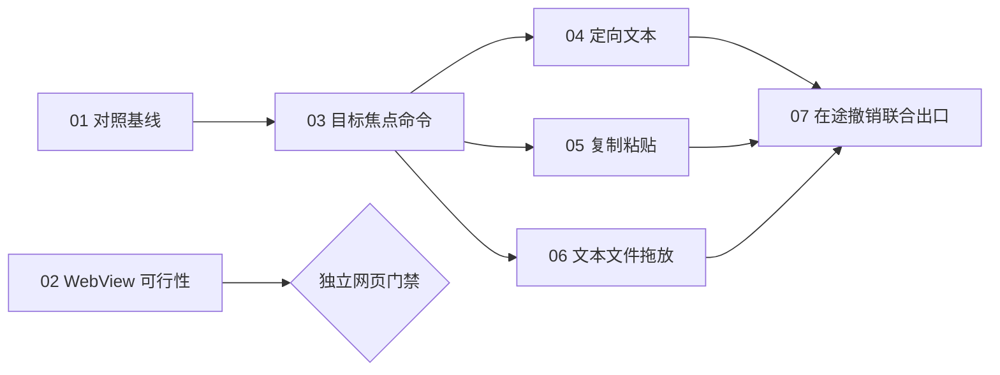

# 共享 UI S0／S1：本地实施工单

日期：2026-10-25。稳定标识：`shared-ui-foundation`。

来源：[细化规格](../../specs/shared-ui-s0-s1.md)、[总路线图](../../specs/shared-ui-roadmap.md)。

状态：本地规划／待实施。所有工单未启动，尚未执行任何验收。用户只授权本轮文档和本地拆单，不创建 GitHub issue、不提交或推送；本地编号不是远程议题号，也不自动授予实施授权。

模式：**端到端垂直切片**。每张功能单同时包含契约、共享实现、宿主／插件适配和验收，不按技术层拆单。两张 S0 调查单是独立的证据交付，不虚构产品行为。工单按仓库约定存放在本目录，不采用 skill 默认的临时目录；配置中的 GitHub 跟踪器本轮不发布。

## 工单与真实直接依赖

| 编号 | 优先级／阶段 | 交付 | 必须先完成 |
| --- | --- | --- | --- |
| [01](01-shared-input-baseline.md) | P0／S0 | 宿主与插件输入的共享行为对照基线 | 无 |
| [02](02-webview-feasibility.md) | P0 技术调查／S0 | 冻结依赖条件下的 WebView 原生可行性结论 | 无；参考 01，不构成硬依赖 |
| [03](03-targets-focus-commands.md) | P0／S1A | 三类原生目标的身份、焦点和命令闭环 | 01 |
| [04](04-scoped-text-tools.md) | P0／S1B | 编辑器、输入框与只读弹窗的定向文本工具 | 03 |
| [05](05-targeted-clipboard.md) | P0／S1C | 异步复制粘贴仍作用于原目标 | 03 |
| [06](06-native-drag-drop.md) | P0／S1C | 文本／文件在宿主与插件间受控投递 | 03 |
| [07](07-cross-interaction-revocation.md) | P0／S1 联合出口 | 在途交互撤销与共享接入联合验收 | 04、05、06 |

共同修改协议或宿主适配器需要协调，不自动构成功能阻塞。03 内先形成共用目标守卫与原生状态操作的必要接缝，再完成命令场景；04／05／06 各自使用该接缝，不依赖翻译策略或对方的公开操作。

07 有独立集成门槛：三个异步路径单独通过后，仍可能在同一目标代际、事件流、模态、IME 或实例退役时互相干扰。该单只验证跨切片竞态与资源撤销，不重新遍历全部字段、剪贴板或文件选择用例，不建立跨控件全局 Undo。

## 门禁与后续阶段

| 门禁 | 满足条件 | 放行内容 |
| --- | --- | --- |
| G0-native | 01 完成，现状与缺口可审查 | 03；不要求 WebView 可行 |
| G0-web | 02 给出可行，或有条件结论的全部条件得到验证 | 后续 WebView 实施；02 调查完成但负面／未验证结论不能放行 |
| G1-target | 03 完成，目标与原子守卫契约稳定 | 04／05／06；S2A、S2B、S3 的独立实现准备 |
| G1-text | 04 完成 | 后续组件宣称支持通用读取／替换；原生字段和列表不必等待翻译业务 |
| G1-shared | 07 完成 | 宣称 S1 整体共享交互基线完成；各切片仍须先独立验收 |

- S2A／S2B／S3 可以在 G1-target 后按自身契约准备实现；包含通用文本工具的交付要满足 G1-text，不能把未完成切片当作已可用能力。
- S4 继续依赖 S2A、S2B；其完整复制粘贴交付另需 05，代码型单元格再依赖 S3。
- S5A 依赖 G0-web 与 G1-target，不依赖 DataGrid 或整个剪贴板／拖放分支；S5B 另依赖 S3 文档生命周期。
- 本轮只拆 S0／S1，未创建 S2–S6 的实施工单。剩余阶段不能仅凭本目录自动启动。

## 共同实施与验证规则

- 保留 Kit 正式入口，不 fork、不升级既有依赖、不引入组件运行时；通用原生实现归本地 UI 模块，插件只传描述和资源句柄。
- 每个功能切片至少通过宿主直接调用和实际包经公开 Manager 接入两条路径验证，不新建插件专用宿主操作或测试专用公开入口。
- 编号验收项均给出方法和结果预期。状态、终态、权限和异常只通过可观察结果验证；不以内部变量或源码行数作为通过条件。
- 01 是只读调查；02 的探针只在之后获实施授权时运行，不在本轮编写或执行。技术探针与其他源码快照使用独立输出目录并核对 workspace／target。
- 每个代码实现阶段先运行受影响模块测试，再执行 `cargo fmt --check`、`cargo test --workspace --exclude editor-app`、`cargo check --workspace`；宿主改动补相关应用测试和真实原生交互。
- 实际 WASM 包按当前直接构建入口准备夹具，再显式执行相关 ignored 测试。保留既有用户数据，不恢复随附插件源码；未完成、跳过或缺环境的项目单独记录。
- 新能力与权限同批更新协议、包准入、授权提示、运行时、SDK 和消费者；本地规格中的新名字目前不可调用。新增权限按既有安装／更新确认流程处理，不在正常调用时反复弹窗。
- 每张工单完成后才更新其本地状态和证据链接。联合出口不豁免各单检查，也不将 WebView 未验证状态伪装成原生失败。

## 验收归属

| 规格编号 | 主责 |
| --- | --- |
| F01–F02 | 01 |
| F03–F04 | 02 |
| F05–F07 | 03 |
| F08 | 03 元数据、04 内容授权 |
| F09–F11 | 04 |
| F12–F13 | 05 |
| F14–F15 | 06 |
| F16–F17、F19 | 07 |
| F18 | 03 基础、07 联合 |
| F20 | 各功能单基础、07 联合 |

所有新功能、技术门禁和验收结果当前均为待实施／未运行，不标记为已完成或已发布。
