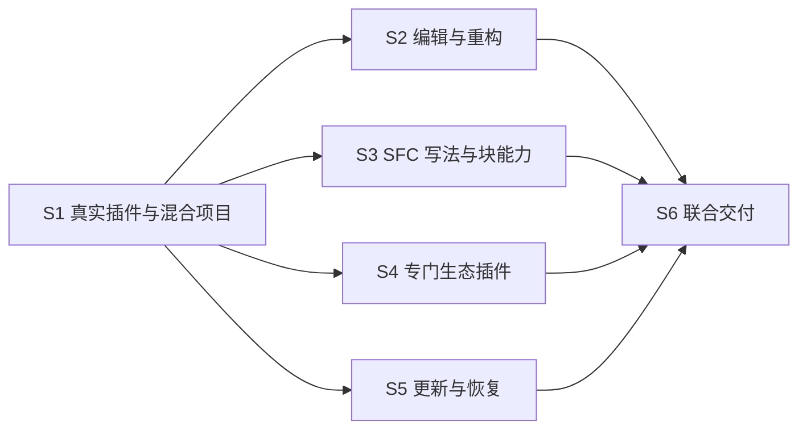

# Vue 与 TypeScript 剩余工作重拆草案

> 本文保留 2026-10-15 用户批准的拆分方案。2026-10-19 只恢复 #121；#122–#126 继续暂停。当前范围以[执行索引](README.md)及[本轮恢复记录](../../verification/vue-typescript-s1-resume-2026-10-19.md)为准，以下历史实施顺序不授权启动暂停工单。

日期：2026-10-15。模式：**场景拆分**，由用户在本次规划明确选择。状态：**用户已批准六场景方案，开始发布工单并连续实施**。发布编号与实施进度以工单索引和 publication 映射为准。

用户要求保留已执行进度、重拆未执行工作并继续完成。本文以[原方案](../../specs/vue-multi-backend.md)、旧工单 #108–#118、[暂停检查点](../../verification/vue-typescript-paused-2026-10-15.md)和本次只读核查为依据；不改变首批范围或正式支持标准。

## 进度如何保留

- 保留原工单编号、正文、实现、候选包、测试结果及失败记录。GitHub 的 11 张工单仍开放，没有一张完成整体验收；“未关闭”不表示“未执行”。
- 旧 01–08 已有较多实现；09 有公开消费者夹具，尚无真实扩展贡献；10 有租约、撤销与隔离基础，尚缺联合恢复验收；11 的最终联合交付尚未完成。
- 以下 S1–S6 **只承接剩余实现和验收缺口**，已有行为及适用测试直接复用。历史通过结果注明对应源码/产物，后续改动影响其结论时补跑，不把旧状态的通过报告成最新工作树通过。
- 获批后为剩余场景建立新工单，回链原工单及逐项验收映射；原工单记录已验证、已写未验证、尚未实现三类范围。用户后续明确只执行新 #121–#126；旧 #108–#118 保留历史记录，不再推进或关闭。
- 不修改或关闭父设计议题 #107。新场景关联到该父议题；父议题的状态不构成实施门槛。

## S1：安装真实插件并打开混合项目

**Blocked by：**无，可从暂停断点继续。

**What it delivers：**独立 TypeScript 插件可单独使用；安装 Vue 插件后，同一工作区的 Vue 2.6、2.7、3 子项目获得正确的首轮语言分析。先修复现有编译断点、公开源版本元数据和首次提供者附着失败，再从真实包进入公开宿主验证，不重新实现已有底座。

**Why separate：**实际安装、上下文解析、受管适配和首次同步共同组成后续场景的真实前置条件；这些步骤共享同一调用链，合并验收可以避免分别证明通用机制后仍无法启动实际插件。

**Acceptance and verification：**

- [ ] S1-AC1：当前宿主和 SDK 可编译，控制请求按用途选择目标快照或关联上下文快照；公开消费者使用原生文档身份/revision，不猜内部 LSP wire version。自动化验证源元数据封印、伪造元数据拒绝及 resolve/attach 不因自身改变项目图而失效。
- [ ] S1-AC2：有配置与无配置 JS/TS 项目均有可解释上下文；Vue 停用时 TS 仍提供七项基础能力。通过真实包的宿主测试观察结果，复用并核对既有 TS rename 证据，记录实际引擎与项目配置。
- [ ] S1-AC3：固定的 Vue 2.6.14、2.7.16、3.5.22 与 TS 5.9.3 候选组合同时打开，正确分离后端和项目配置；模板补全、诊断、悬浮、跳转、引用指向真实源位置，无重复诊断或虚拟 URI 泄漏。真实 production Worker 联验必须进入适配和分析阶段，不能以进程启动代替。
- [ ] S1-AC4：版本证据、显式选择和主提供者选择可追溯；未知/冲突版本不套用最新版，新提供者不覆盖有效选择。测试规范项目根、合法链接及越界链接、实例归属与错误项目绑定；按需准备不在只读 hook 内进行。
- [ ] S1-AC5：未知消费者能通过公开契约 resolve/describe/analyze/release，查询上下文、能力与引擎版本，不能借用提供者私有句柄或权限；缺失 TS、缺失/不兼容引擎和错误显式工具路径产生结构化错误，不私建 TS 引擎、不自动安装插件或静默更换工具。
- [ ] S1-AC6：模块仅进入受管分析进程，完整闭包、摘要、入口、ABI、来源/接收方与权限均校验；加载用途和原生运行方式纳入安装/更新授权，明确模块间不具备 WASM 隔离。相同字节可复用缓存，各消费者授权独立，不兼容组合使用独立工作进程。复用真实未知模块测试，并补齐双方、多消费者及进程隔离验收。
- [ ] S1-AC7：未知语言包仍可复用上下文及模块能力；所有宿主 API 通用，不引入 Vue/TS/插件 ID 专属分支。测试项目文件与全局环境不变，缓存和生成视图不写项目。
- [ ] S1-AC8：控制通道协商协议版本与方法范围，版本不匹配明确拒绝，请求和响应准确关联；帧/并发/积压预算、背压、超时与取消可观察。业务错误和取消不破坏共享连接，大结果有界返回或显式失败。运行交错请求、边界及压力回归，文档正文继续走原生同步。

**Checks：**受影响协议、运行时、TS 插件、真实包与宿主定向测试，以及仓库规定的格式、非 UI workspace 测试和 workspace check；实际 WASM 用例显式运行 ignored。首轮状态及结果以 Windows 原生宿主观察。

## S2：在混合项目中编辑、补全和跨文件重构

**Blocked by：**S1。

**What it delivers：**用户修改共享 TS、Vue 或外部源文件后，所有相关项目使用相同未保存快照；界面展示选定上下文，自动导入和跨组件重命名可安全预览、取消、应用及撤销。

**Why separate：**依赖 S1 的实际服务与版本封印；本场景集中处理文档图、映射、编辑事务及原生交互，具有独立可演示结果。将这些行为合在一起能复用同一批脏文档和冲突夹具。

**Acceptance and verification：**

- [ ] S2-AC1：共享 TS 未保存改动同时影响相关 Vue 2/3 分析，磁盘不变；TS 管理主提供者及展示上下文，用户选择在本机保存，辅助同步不额外发布诊断。真实混合仓库测试切换、来源继承与歧义选择。
- [ ] S2-AC2：配置、实例、文档关闭重开、revision 或映射代次变化使旧请求、诊断、补全及预览失效；只重建受影响上下文。自动化注入乱序、取消及依赖变化，验证无旧结果提交。
- [ ] S2-AC3：超过普通 RPC 大小和既有文档枚举上限仍完整同步；断流、事件丢失及队列溢出后重新建立水位，不静默截断。自动化大文档、多文档及重同步边界用例。
- [ ] S2-AC4：逐文档 language ID、稳定源 URI、外部 src、路径别名、项目引用及合法包管理器链接保持正确解析；IME、CRLF、UTF-16 代理对和组合字符的位置准确。以自动化映射/导航测试和原生实际输入验证。
- [ ] S2-AC5：选择补全时 resolve，主编辑和全部自动导入一起校验并原子应用；来源或任一附加目标失效则全拒绝。运行真实 TS/Vue 自动导入及未知语言回归。
- [ ] S2-AC6：跨 Vue/TS 符号重命名包含全部必要编辑；未打开目标进入正常文档会话后重新分析。预览完整、取消无副作用、提交不自动保存、分组 Undo 恢复全部目标，以真实原生交互及测试验证。
- [ ] S2-AC7：越界、只读、源/目标或辅助输入冲突、关闭重开、重叠编辑和必要映射缺失拒绝整个计划；文件移动、资源操作与任意 LSP command 明确拒绝。测试非法尾部不能产生有效前缀的修改。
- [ ] S2-AC8：复用唯一 EditorState/DocumentSession 和事务；无第二份可写文本或 Undo 栈。未知语言同样通过编辑计划，回归现有单文档编辑、撤销和提供者选择。

**Checks：**文档图、同步、编辑计划与插件定向测试，相关 editor-app/真实包 ignored 测试、Windows 原生交互及仓库强制检查。S6 承担与生态转换及更新恢复组合后的整体验证。

## S3：使用首批 Vue 写法、SFC 高亮和块格式化

**Blocked by：**S1。

**What it delivers：**完成首批三种 Vue 候选组合的写法语义、编辑提案、SFC 高亮和块格式化；工具及受管包层分别验证七项能力，安全编辑的宿主事务组合与正式支持标记须在 S2+S3 的 S6 联合验收通过后完成。

**Why separate：**本场景共享兼容夹具、后端映射和 SFC 块处理，合并旧 07/08 的剩余工作；其主要实现位于独立 Vue 包，可以在稳定的 S1 契约上与重构、生态协作并行。复杂重构沿用 S2 的通用事务，最终组合在 S6 验证，不把 S2 机械设为本场景全部工作开始前的阻塞。

**Acceptance and verification：**

- [ ] S3-AC1：Options/Composition、script setup、JS/TS 及 Vue 2 Composition API 扩展的每个声明组合均按目标版本合法范围覆盖七项适用语言能力；非法语法正确诊断，合法样例无误报。每项固定依赖组合及适用/不适用原因。
- [ ] S3-AC2：类组件、装饰器、JSX/TSX 各自覆盖七项语言能力、props/slots 推断、自动导入及跨文件引用/重命名。既有 props 样例作为回归，不外推成全部能力已验收；S3 验证工具/受管包的语义与编辑提案，历史组合的安全应用、预览/取消/Undo 和正式支持标记须等待 S2+S3 在 S6 联合通过。
- [ ] S3-AC3：外部 JS/TS src、不同合法导出形式与路径解析不依赖开发目录；对不支持的动态语义给出准确限制或完成补充实现，不把有限静态样例泛称全覆盖。密封受管 loader 与真实包均有证据。
- [ ] S3-AC4：宿主实际 Tree-sitter loader 加载插件 WASM grammar 和查询；Vue、JS/TS/JSX/TSX、CSS/SCSS/Sass/Less 的注入及可见高亮正确，停用后撤销。缺少块 grammar 时不冒充其他语言。
- [ ] S3-AC5：整文件与适用块范围格式化保留 SFC 结构、属性及外部 src；CSS/SCSS/Sass/Less 的已承诺块能力通过。独立格式化选择与配置生效，安装 Vue 不覆盖有效提供者；测试脏文本、CRLF/Unicode 和过期结果全拒绝。
- [ ] S3-AC6：缺失块语言或专门插件时准确显示能力不足，其他能力继续；深浅主题、焦点、键盘、中文 IME、滚动及缩放按改动范围原生验收。
- [ ] S3-AC7：兼容修复属于插件或通用公开契约，不写宿主白名单；受管闭包不命中开发依赖，来源、许可、传递依赖、摘要、生成缓存与真实包对应。工具或插件升级后的保留回归由 S5/S6 验证。

**Checks：**Vue/TS 工具层兼容全集、密封 loader、宿主 grammar 和 SFC 定向测试，真实包原生输入/可见结果及强制检查。范围格式化和历史完整能力是现存缺口，不能降格为仅高亮或诊断支持。

## S4：安装专门生态插件参与 Vue 分析

**Blocked by：**S1。

**What it delivers：**宿主从未认识的扩展插件可通过公开角色贡献转换、配置和类型等能力，安装、替换及移除后 Vue/TS 正确组合并撤销结果。

**Why separate：**真实贡献协议尚未完成，与纯消费者不同；它有独立插件安装和可观察转换效果，适合独立交付。对现有公开项目契约作兼容扩展，避免阻塞 S2/S3 的既有调用路径。

**Acceptance and verification：**

- [ ] S4-AC1：竞争单选提供者与独立可组合扩展分别发现；声明模板转换、样式处理、项目配置和类型适配角色。异步准备阶段汇集贡献，不在只读语言 hook 调服务、不把普通 Open 当广播。
- [ ] S4-AC2：至少一个真实未知贡献插件产生可观察的转换/配置/类型贡献，并用角色夹具覆盖组合与竞争；不把现有 A/B 纯消费调用作为贡献验收。配置与生成文件不写用户项目。
- [ ] S4-AC3：转换携带源快照与映射，组合后诊断、导航和安全编辑仍回到准确源位置；不可逆或过期必要映射全拒绝。自动化组合映射、乱序结果及原生结果观察，S6 验证与 S2 事务完整组合。
- [ ] S4-AC4：模块集合可协商，ABI、引擎、顺序环或配置冲突显式报告，不按安装顺序覆盖；有竞争、兼容组合、不兼容组合与错误配置回归。
- [ ] S4-AC5：未知插件安装、替换、移除不修改宿主或 Vue 核心路由；旧调用、映射、通道和模块进程退休，其他有效消费者保留。A/B 原始消费者退出与多跳调用链纳入生命周期回归。
- [ ] S4-AC6：缺少专门插件只降级受影响角色，明确状态并保留其他功能；本场景不扩大为 Pug/Stylus/Nuxt 正式业务插件，后者仍由独立任务实现。

**Checks：**公开契约、组合/冲突与租约定向测试；独立构建的未知贡献包经公开 Manager 及宿主显式 ignored 联验；原生结果、强制检查和无专属分支审查。

## S5：在离线、更新或后端故障后恢复使用

**Blocked by：**S1。

**What it delivers：**准备失败、离线、包更新、某一后端崩溃及撤销授权时，用户看到准确状态，可保留或恢复已可用组合，无关项目继续工作。

**Why separate：**恢复涉及受管依赖、安装事务、模块租约和上下文生命周期，具有独立可验证的失败注入场景；可以基于 S1 的实际包并行补齐。S4 的扩展更新与 S2 的脏编辑组合在 S6 集成验证，避免把建议顺序当成硬阻塞。

**Acceptance and verification：**

- [ ] S5-AC1：候选准备失败保留旧实例；激活失败恢复旧包及受管私有数据，并可重新启动旧兼容组合。用真实更新/回滚流程验证，不声称恢复进程内存或跨包原子安装。
- [ ] S5-AC2：TS/Vue 更新不兼容时保留可选择的可用组合或拒绝切换；不静默降低 Vue 2 等历史已验收能力。实际切换测试重跑保留矩阵，未知未来版本不自动获得正式支持。
- [ ] S5-AC3：下载取消、坏摘要、首次/缓存/离线准备、并发去重、独立共享租约及回滚收据均有真实测试；不修改全局环境、项目依赖或静默升级插件。
- [ ] S5-AC4：一个版本后端退出只影响所属上下文，重试有预算且可停止，另一 Vue 版本仍可继续补全/诊断；合法业务错误与取消不触发无关重启。
- [ ] S5-AC5：导出方/接收方卸载、更新、崩溃、撤信任或工作区关闭时，先终止相关受管进程树，再释放租约；无旧通道、请求、映射、诊断和可用引用。多消费者及私有缓存清理有完整联验。
- [ ] S5-AC6：配置或上下文变化只退休相关绑定，乱序准备不回写旧状态；关闭重开文档使用新身份，有限恢复后不泄漏上下文引用或积压通知。
- [ ] S5-AC7：中英文阶段、失败原因、版本证据、受影响项目及恢复入口准确；正常请求不反复弹权限确认。验证准备、启动、索引、失败、恢复状态及相应原生交互。

**Checks：**依赖、更新事务、模块/消费者撤销与上下文故障回归，真实包故障注入、进程/租约归零、Windows 状态交互及仓库强制检查。S6 负责多场景叠加后的最终回归。

## S6：完成跨插件联合验收与可审核交付

**Blocked by：**S2、S3、S4、S5。S1 为传递依赖，不重复列直接边。

**What it delivers：**在同一宿主、SDK、真实插件包及 Windows 环境下，完整证明首批范围可用，交付准确的支持清单、构建产物、审查记录及推送结果。

**Why separate：**存在独立集成门槛：SFC 历史矩阵、跨文件事务、生态转换和更新恢复会共同改变项目图、映射及实例代次，单场景通过不足以证明其组合正确。本单承担跨工单验证与最终交付，不另拆纯格式检查或单个测试工单。

**Acceptance and verification：**

- [ ] S6-AC1：原方案 V01–V14 全部适用场景有明确的命令、实际结果、源码/产物版本、摘要和原生证据。覆盖 S2+S3 的历史写法重构、S2+S4 的转换映射事务、S2/S4+S5 的更新或撤销期间旧结果全拒绝。
- [ ] S6-AC2：受影响定向测试、`cargo fmt --check`、`cargo test --workspace --exclude editor-app` 和 `cargo check --workspace` 通过；涉及真实 WASM 的 ignored 用例构建后显式执行。未运行、忽略或失败不记作通过。
- [ ] S6-AC3：真实编辑、补全选择、诊断、悬浮、跳转、引用、重命名预览/取消/撤销、格式化及混合项目上下文切换有 Windows 原生输入与可见结果验收，不能只凭编译或工具层测试。
- [ ] S6-AC4：两个独立插件从当前宿主内嵌 SDK 缓存构建，不复制 SDK、不依赖宿主内部路径、不调用历史 scripts；清单版本、能力/协议版本、Cargo.lock、归档摘要、许可与兼容账本对应实际产物。支持范围如实区分正式、基础、待适配和限制，早期及未来版本仍按已确认长期准入保留和扩展，不冒称全部已支持。
- [ ] S6-AC5：完成规范与规格双轴审查；每个发现有修复或明确依据。本任务变更与原始工作区其他改动隔离；最终检查覆盖最终源码而非旧候选包。
- [ ] S6-AC6：历史后端、离线和回滚行为文档准确，已有用户数据保留；未实测平台明确列为未验收，后续增加版本须跑保留矩阵。
- [ ] S6-AC7：逐项记录新 #121–#126 的验收与提交关系，普通提交后推送 origin、核对远程并读回对应 issue 状态；只关闭已完成的新工单，旧 #108–#118 不再推进或关闭，父设计议题保持不变。交付构建候选，不创建 Release 或发布版本。

## 真实阻塞边与实施顺序

S1 先打通真实宿主闭环；S2–S5 可准备并行，实际编辑按共享文件和契约的冲突风险协调。S3/S4 的跨文件安全编辑组合，以及 S4 的更新叠加场景，在 S6 验收，不将验证所需的建议顺序误写成全部工作开始前的阻塞边。所有场景遵守仓库每阶段强制检查；复用定向测试不豁免门禁。

## 旧验收项逐项承接

旧工单的 AC 序号按其原正文列表顺序计算。多处承接表示分别覆盖基础行为和集成/故障路径；已有完成证据仍留在原验证记录。下表是追踪映射，不是完成声明。

| 旧工单 | 原 AC → 新场景 AC |
| --- | --- |
| 01 / #108 | 1→S1-2；2→S1-2；3→S1-5；4→S1-5；5→S2-5/6、S3-2；6→S1-7、S3-7 |
| 02 / #109 | 1→S1-3；2→S1-4/7；3→S1-4、S2-1；4→S1-4、S5-3；5→S2-2、S5-6；6→S1-7 |
| 03 / #110 | 1→S1-6；2→S1-6；3→S1-8；4→S1-6、S5-2/5；5→S5-5；6→S1-6/7、S5-3 |
| 04 / #111 | 1→S1-3；2→S1-4；3→S1-3、S2-4；4→S1-5；5→S3-2；6→S5-5 |
| 05 / #112 | 1→S2-1；2→S1-1/3、S2-4；3→S2-2；4→S2-3；5→S2-4；6→S2-1/8 |
| 06 / #113 | 1→S2-6；2→S2-5；3→S2-7；4→S2-6/8；5→S2-7；6→S2-8 |
| 07 / #114 | 1→S3-1；2→S3-2；3→S3-7；4→S3-7、S6-4；5→S5-2、S6-4/6 |
| 08 / #115 | 1→S3-4；2→S3-5；3→S3-5；4→S3-6；5→S3-6、S2-2 |
| 09 / #116 | 1→S4-1；2→S4-1；3→S4-3；4→S4-4/5；5→S4-2/5/6 |
| 10 / #117 | 1→S5-1；2→S5-2；3→S5-3；4→S5-4；5→S5-5；6→S5-7 |
| 11 / #118 | 1→S6-1；2→S6-2；3→S6-3；4→S6-4；5→S6-5；6→S6-4/6；7→S6-7 |

V01–V14 验证责任：V01/V03/V04/V09 以 S3 为主；V02/V05/V06/V07/V08 以 S1/S2 为主；V10 以 S4 为主；V11/V12/V13 以 S1/S5 为主；V14 由 S1/S2/S4 的未知插件夹具覆盖。S6 对全部跨场景组合及最终产物负责。
