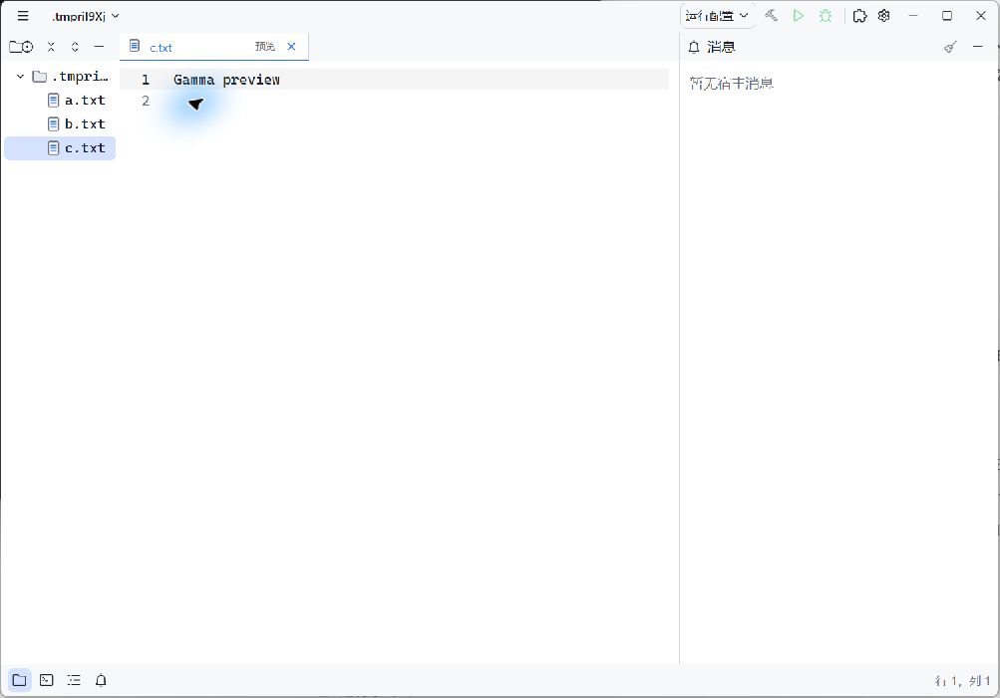
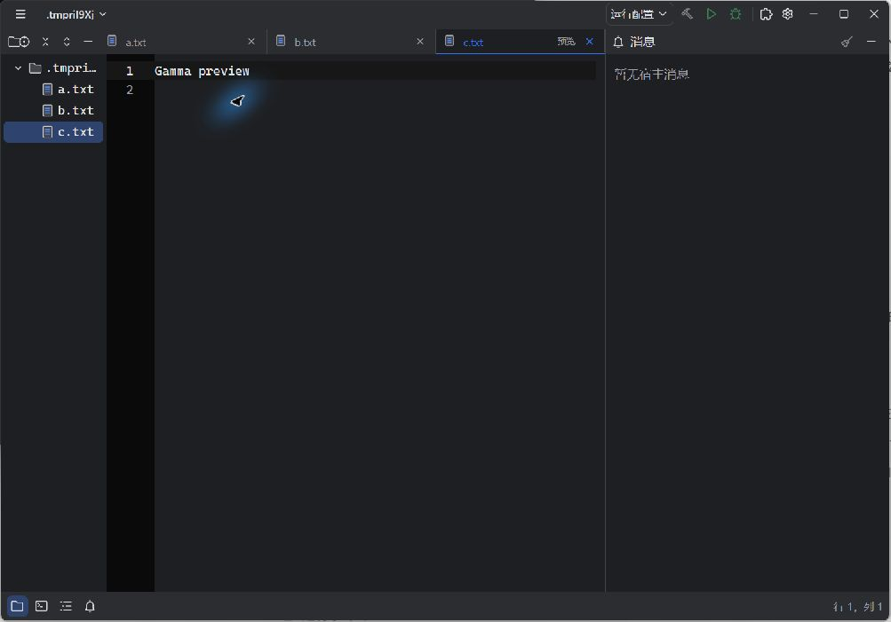

# 资源管理器预览标签

日期：2026-10-14。状态：本次行为实现、针对性测试、双轴增量审查及 Windows 原生验收完成。完整应用测试保留 8 个已有失败，未提交、推送或发布。

## 已确认的行为

- 资源管理器单击文件打开预览，同一窗口最多一个预览，后续未打开的文件在原位置替换它。
- 双击资源管理器文件、双击预览标签或首次实际内容编辑，将标签永久固定。保存和撤销不恢复预览状态。
- 文件已经打开时直接切换到原标签，保留固定状态和另一个预览，不重复打开。
- 仅资源管理器单击新增预览行为。其他显式打开入口固定文件；文件夹及方向键原有行为继续保留。
- 单击预览保留资源管理器焦点；双击文本文件后进入编辑区。图片等文件继续使用原有文件查看能力。
- 预览显示本地主题的淡色中英文标记。固定后标记消失，不占用工作区外文件已有的斜体含义。
- 会话只记录固定文件；仅有预览时保存为空文档会话，重启不自动打开默认文件。首次打开工作区仍使用原有默认文件，显式文件请求仍优先打开。

## 实现与回归边界

`OpenTab.preview` 与 `DocumentSession` 的 dirty/revision 分离；固定操作只允许从预览转为固定。每次替换先准备新文件，准备失败保留原预览。释放旧预览复用正常关闭的语言、插件及原生文本资源撤销流程，不保留第二份可变文本或 Undo 栈。

上游 Base 在文件末尾 Delete、同文替换时也会发出 Change，预览需通过已有磁盘摘要识别实际内容变化。IME preedit 暂不发 committed Change，因此替换同时检查原生文本和待处理输入，确保旧文档的组合输入不被丢弃。会话是否成功加载使用 `serde(skip)` 标记，不改变既有磁盘格式。

新增测试位于 [`preview_tabs.rs`](../../../crates/editor-app/src/tests/preview_tabs.rs)，已有资源管理器点击测试同步更新为已确认的新行为。标签使用 gpui-base 的无外观 Tab 原语及本地 UI 标记，未引入上游成品外观。

## 自动验证

| 命令 | 实际结果 |
| --- | --- |
| `cargo test -p editor-app preview_tabs -- --test-threads=1` | 9 passed、0 failed、0 ignored；覆盖复用、已有标签、双击、编辑/撤销/保存、PNG、IME、无变化输入、打开失败及两种重启场景 |
| `cargo test -p editor-app file_single_click_previews_and_double_click_keeps_existing_tab -- --nocapture` | 初始 1 failed，实施后 1 passed；最终全量单线程运行也通过 |
| `cargo fmt --check` | 通过 |
| `cargo test --workspace --exclude editor-app` | 默认环境先因链接器找不到 `msvcrt.lib` 失败；初始化本机已安装的 MSVC 环境后为 274 passed、0 failed、256 ignored |
| `cargo check --workspace` | 通过，保留已有警告 |
| `cargo test -p editor-app -- --test-threads=1` | 563 passed、8 failed、236 ignored；新增 IME 用例及 PNG 夹具随后单独运行最终针对性测试通过 |
| `cargo build -p editor-app` | 通过，使用此 Debug 原生程序验收 |
| `git diff --check` | 通过 |

MSVC 初始化直接调用 `C:/Program Files/Microsoft Visual Studio/18/Community/Common7/Tools/VsDevCmd.bat -no_logo -arch=x64 -host_arch=x64`，随后直接执行 Cargo；没有安装或升级工具链。全量应用的默认并发运行分别出现 31/34 个失败，按仓库现有的单线程方式复验后只剩已有 8 个失败。未将 ignored 计入通过。

七项语言状态、定义跳转及 Worker 文案失败与[项目窗口基线](project-windows-main-integration.md)一致；第八项 `incompatible_plugin_details_keep_preferences_and_update_uninstall_actions` 在[路径显示验证](windows-path-display.md)已记录为修改前可复现的已有失败。本任务不修正这些范围外问题。

## Windows 原生验证

使用临时工作区、独立 profile 及预置受限工作区记录验证，未更改日常配置或启用插件。通过单击复用、方向键保留树焦点、双击文件/标签固定、点击正文输入中文、Undo、显式保存、关闭标签及深浅主题可见标记。中文组合输入阶段及提交归属由 GPUI 原生输入接口测试覆盖。

只留下未编辑的 `c.txt` 预览后，读回隔离会话为 `open_tabs: []`、`active_file: null`；正常退出并重新打开同一工作区，实际窗口显示空编辑区，没有恢复 `c.txt` 或默认 `a.txt`，见[重启截图](assets/explorer-preview-tabs-restored-empty.jpg)。

原生程序 SHA-256：`82ec200b6fe3dcd9e7126157962a03a44044d184f06a4bcd5eef1e6e748977d4`。

## 审查与证据

按执行流程进行 Standards / Spec 两轴只读审查，比较点为本次改动前的文件快照。因工作区已有大量未提交内容且本任务未获提交授权，审查覆盖本任务增量，不声称进行了仅支持 commit 到 HEAD 的技能原始比较。Standards 0 项发现；Spec 最初发现无变化输入与空会话 fallback 两项问题，修复后复核 0 项剩余发现。

实际日志位于 `C:/Users/Tmiracle/.codex/visualizations/2026/10/14/01a139c1-a08f-7d00-ba7e-4cd43bb19b97/preview-tabs/`；任务前快照位于 `C:/Users/Tmiracle/AppData/Local/Temp/nanobug-preview-baseline-20261014/`。图片/二进制测试覆盖宿主标签生命周期，未安装插件查看器，也未重新执行不受本次改动影响的实际 WASM 包测试。

返回[原生 UI 目录](../README.md)。
