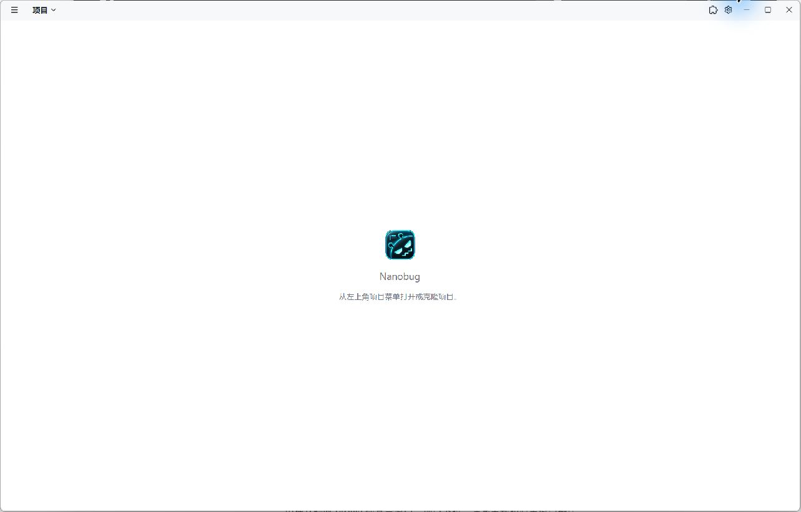
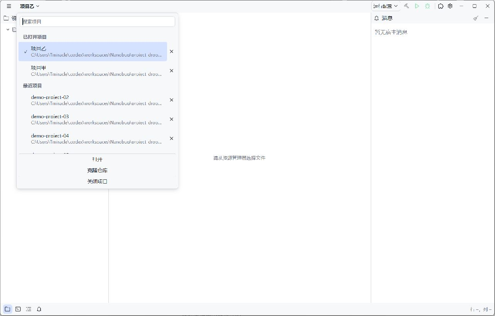
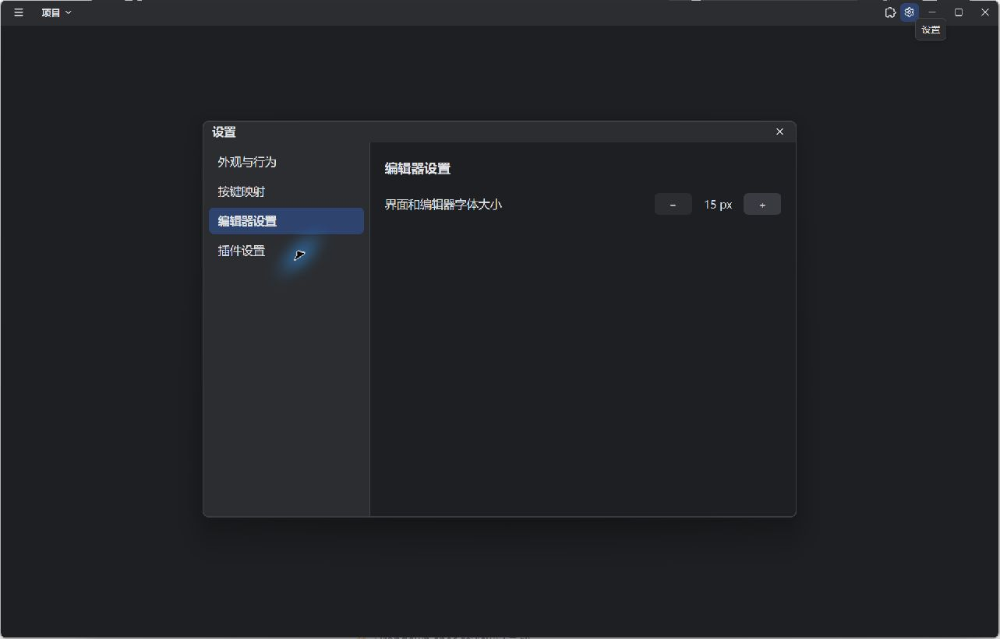
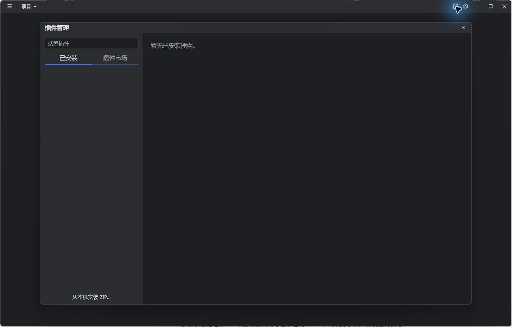

# 项目下拉与空启动验收

日期：2026-10-14。状态：本次范围已实现，项目交互与公开包管理回归、双轴增量审查和 Windows 原生验收完成；完整 UI 尚有 8 项范围外失败，未记为全量通过。未提交、推送、关闭工单或发布。

## 行为与边界

依据[已确认规格](../specs/project-menu-startup.md)，独立启动页已移除。无路径启动使用普通编辑器标题栏，允许没有项目，项目下拉默认收起。左上角同一个下拉提供搜索、已打开/最近分组、打开、克隆、移除历史、关闭当前项目；兼容应用菜单与 Ctrl+Shift+N 入口。

- 空窗口不构造 Workspace、EditorApp、文件树、语言提供者、监视器、终端或运行配置。设置和插件管理使用既有原生对话框；项目覆盖、语言配置、工作区信任和布局只在真实项目中显示。
- 从空窗口打开项目使用当前窗口；从活动项目打开不同目录创建另一窗口，同目录激活已有窗口。再次无参数启动激活同一 profile 最后使用的编辑器窗口，不创建欢迎窗口或丢失文档。
- 关闭项目完成保存/运行资源确认和清理后关闭原生窗口，最后一窗关闭后退出。取消关闭保留文档和克隆进程。移除最近记录只改变历史成员资格，不删除文件或关闭窗口。
- 搜索以 Base InputState 为行为基础，匹配名称和完整显示路径、忽略大小写，保留真实目录身份。打开、克隆与关闭操作固定在列表底部，长列表独立滚动。中文输入、Enter 选择、方向导航、Escape 与原焦点恢复沿现有输入契约处理。

无项目插件管理通过公开 Manager 的应用管理投影读写 profile。工作区包可以首次安装、保存 User 配置、启停和卸载，尚未初始化的 WASM 私有作用域推迟到实际受信任项目；保留旧数据重装也维持首次安装的可选依赖语义。不同版本的工作区更新及包合并要求真实受信任项目，以保留迁移和旧版本回滚。应用作用域包仍走正常事务。全局启用默认、项目覆盖及真实项目的异步队列不会因空管理投影而转移或改变。

主题和字号沿用既有应用内全局状态；本次没有引入新的跨进程主题/字号持久化格式。用户层插件配置继续由原设置存储持久化。

## 代码入口

- [原生窗口状态](../../../crates/editor-app/src/app/projects.rs)、[空编辑器组合](../../../crates/editor-app/src/app/projects/empty.rs)、[共享项目下拉](../../../crates/editor-app/src/app/projects/switcher.rs)、[窗口协调器](../../../crates/editor-app/src/app/projects/controller.rs)。
- [关闭门禁](../../../crates/editor-app/src/app/projects/close.rs)、[克隆生命周期](../../../crates/editor-app/src/app/projects/clone_repository.rs)、[全局设置所有者](../../../crates/editor-app/src/app/settings/owner.rs)。
- [本地菜单状态与行为](../../../crates/editor-app/src/ui/controls/menu.rs)、[菜单绘制](../../../crates/editor-app/src/ui/controls/menu/view.rs)、[原生标题栏外观](../../../crates/editor-app/src/ui/controls/window.rs)。
- [应用管理投影](../../../crates/plugin-runtime/src/manager/application.rs)、[公开包管理回归](../../../crates/plugin-runtime/tests/application_management.rs)、[空启动回归](../../../crates/editor-app/src/tests/project_home/startup.rs)。

## 自动验证

| 实际命令 | 最终结果 |
| --- | --- |
| `cargo fmt --check` | 通过 |
| `git diff --check` | 通过；Git 仍提示既有行尾转换 |
| `cargo check --workspace -j2` | 通过，保留未使用代码与 Windows 链接器警告 |
| `cargo test --workspace --exclude editor-app -j2 -- --test-threads=1` | 278 passed、0 failed、258 ignored，包含文档测试 |
| `cargo test -p editor-app app::projects:: -j2 -- --include-ignored --test-threads=1` | 40 passed、0 failed、0 ignored，含队列历史、IME 尾输入及双项目语言目录三个显式场景 |
| `cargo test -p plugin-runtime --test application_management -j2 -- --include-ignored --test-threads=1` | 6 passed、0 failed、0 ignored，含两个真实 WASM 包场景 |
| `cargo test -p editor-app -j2 -- --test-threads=1` | 567 passed、8 failed、236 ignored；退出码 101，未记为通过 |
| `cargo build -p editor-app -j2` | 原生 Debug 构建通过 |

真实 WASM 夹具通过 `target/debug/editor-app.exe --plugin-cargo <仓库绝对路径>/crates/plugin-runtime/tests/fixtures/sdk-styles/Cargo.toml build --release --target wasm32-wasip2` 直接重建，Windows 使用短 `CARGO_TARGET_DIR=C:/nb-styles-20261014`。重建 component 与账本固定 ZIP 中的 component 同为 SHA-256 `c2f72166945fb608d91fc41e37084217d6d6a1e346a932401823bfc17606a0db`；未替换已有固定包或摘要账本。显式场景覆盖删除/保留私有数据重装、保留文件哨兵、项目覆盖开启而全局关闭，以及准备不能激活业务实例。

完整 UI 的 8 项失败为：

1. `app::plugins::status_tests::status_popover_preserves_language_loading_and_keyboard_dismissal`
2. `app::plugins::tests::stale_rust_timeout_after_project_reenable`
3. `app::plugins::tests::status_indicators_open_plugin_lists`
4. `editor::definition_tests::ctrl_click_definition_on_declaration`
5. `editor::definition_tests::ctrl_click_definition_releases_source_editor`
6. `editor::definition_tests::middle_click_definition_stays_on_target`
7. `extensions::worker::worker_tests::operation_errors_retain_plugin_ownership_through_worker_publication`
8. `extensions::tests::incompatible_plugin_details_keep_preferences_and_update_uninstall_actions`

前 7 项与[项目窗口集成基线](project-windows-main-integration.md)及[项目下拉旧验收](project-switcher.md)一致。第 8 项期待不兼容包仍显示项目覆盖控件，而本任务开始前的 `extensions/management/actions.rs` 已有 `!incompatible` 隐藏条件；本次新增的非空工作区检查在该测试的真实目录中为真，不影响这个失败。未扩大范围修改其他任务的界面与测试。

初次完整检查遇到 MSVC `msvcrt.lib` 搜索路径缺失，后续命令只在各自进程中设置已安装 VS/Windows SDK 的 `LIB`，未修改系统环境。既有原生进程测试曾在仅等待第二个 PID 标记后读取第一个标记时出现 `NotFound`；最终非 UI 单线程复验通过，没有修改该测试。迁移/资源发布的旧夹具以空 Environment 模拟受信任项目，已改用真实临时目录；队列关闭测试原本检查回到首页的控件，已按新行为检查窗口消失及最终保存内容。

非 UI 与完整 UI 表中的未执行 ignored 项不计通过。网络 Git 认证、macOS/Linux 原生界面及系统输入法的手工组合过程未验收；中文 IME 与队列收尾由实际平台输入处理器的 GPUI 回归覆盖。本地 Git 克隆由 40 项项目测试中的真实受管 Git 进程场景覆盖。

## Windows 原生结果

使用仓库外的隔离 `--profile`、24 个最近项目夹具，以及预存受限模式的两个真实项目，不操作日常 profile 或确认信任权限。检查了：

- 有最近历史时仍空启动且下拉收起；浅/深色外观、中文名称与完整路径忽略大小写搜索、滚动、固定底部操作、Escape 与 Ctrl+Shift+N。
- 空窗口中的全局主题和字号设置，以及真实插件管理对话框。
- 项目甲在当前空窗口中打开，编辑 `readme.txt` 后从下拉打开项目乙，新原生窗口独立存在。切回甲仍显示未保存的 `kept 中文`。
- 重复无参数启动返回成功，两个窗口数量及身份不变，最后使用的甲在前台。
- 保存并关闭甲后，只剩乙，实际文件包含输入内容；关闭最后一个乙后进程退出码 0，未出现欢迎窗口。原生最大化/还原也已检查。

首次验收夹具的会话键/字段不完整时，宿主正常显示信任确认或保护损坏会话；没有在 UI 中授予信任。修正隔离夹具使其遵守原会话格式后，上述项目流程复验通过。

以下截图仅包含隔离验收项目：

## 空窗口文案与文件拖入补充

用户随后要求无项目入口改为“选择文件夹”，并支持向空白区域拖入文件。中英文入口、可访问名称和空区域提示已更新；有项目时仍显示目录名称。外部拖放使用 GPUI 的 `ExternalPaths` 和现有 `open_path`，不复制/移动源文件，不绕过信任、关闭、克隆和目录去重门禁。一次拖放按平台顺序处理首个目标。

GPUI 0.3.7 在记录输入模式后才把 FileDrop 转为指针事件，键盘模式会使普通 drop 命中判定失效。空区域通过公开鼠标事件接口恢复拖放的指针模式，沿原生 hitbox 处理遮挡，没有新建一份输入模式状态或修改工具包源码。新增平台事件回归覆盖打开和受限确认、菜单遮挡、Escape 后再次拖入、待确认目标保持以及取消后重新选择。

本补充的 `cargo test -p editor-app app::projects:: -j2 -- --test-threads=1` 为 40 passed、0 failed、3 ignored；`cargo test --workspace --exclude editor-app -j2 -- --test-threads=1` 为 278 passed、0 failed、258 ignored；workspace check、格式与补丁检查通过。忽略项未在本补充复跑，不计为通过，前文真实包与完整 UI 的结果属于前一阶段。

Windows 使用独立 profile 验收“选择文件夹”文案，并从验收专用资源管理器窗口拖入 `drop-probe.txt`：同一原生窗口打开其真实目录并显示 `Native file drop 中文🙂`，没有新建窗口或修改源文件。自动化工具在跨窗口拖动后返回坐标越界，后续独立刷新确认动作已生效，以实际窗口、文件名和文本为依据。验收编辑器正常退出，用户已有 Release 窗口及资源管理器窗口未操作。截图和日志保留于 `C:/Users/Tmiracle/.codex/workspaces/Nanobug/empty-file-drop-20261014/`。

本补充由当前代理检查任务前快照与最终增量，未重复前一阶段的双轴代理审查或全量 UI 检查。

## Standards

规范轴最终复核：0 项未关闭问题。菜单绘制迁移保留状态和行为归属，私有行构建避免内部项目类型泄漏；首次安装标记、真实作用域恢复、全局默认持久化与卸载清理边界一致，代码与测试注释齐全。没有扩展上游成品外观或为特定插件建立专属能力。

## Spec

规格轴最终复核：0 项未关闭问题。已修正审查发现的异步投影恢复、首次准备语义、保留数据重装、全局默认保持和卸载标记清理；同目录激活、关闭窗口、空管理与真实项目的边界符合已确认规格。

总结：Standards 0 项、Spec 0 项未关闭发现。审查是针对本任务的未提交增量，以任务前文件快照比较；不是 `git diff <commit>...HEAD` 的提交审查，也不覆盖工作区其他任务的全部修改。三个管理/设置上下文文件原快照缺失时仅按当前接缝核对，未将其已有内容归为本次新增。

完整日志与任务前快照保留在 `C:/Users/Tmiracle/.codex/workspaces/Nanobug/project-dropdown-20261014/`，包括 `projects-test.log`、`management-test.log`、`fixture-build.log`、`non-ui-test.log`、`editor-app-test.log`、`check.log`、`build.log` 与 `baseline/`。

返回 [UI 文档目录](../README.md)。
