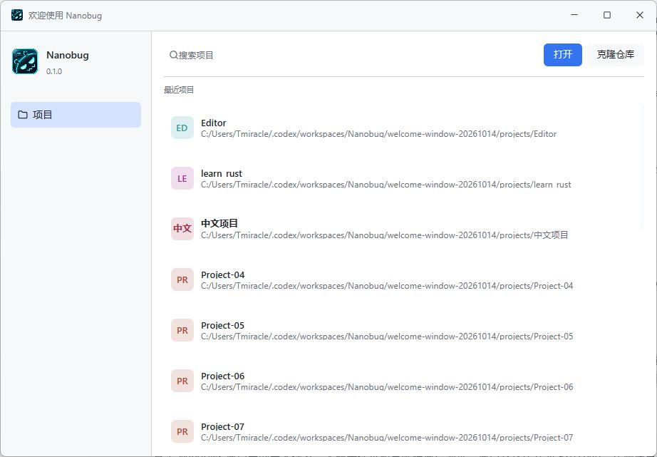

# 独立欢迎窗口重新设计

日期：2026-10-14

历史记录：用户随后撤销独立启动页，当前产品行为以[项目下拉与空启动](../specs/project-menu-startup.md)及其[验收记录](project-menu-startup-2026-10-14.md)为准。以下结果与截图仅描述当时的实现。

状态：实现与项目交互测试完成；Windows 原生浅色界面已验收，深色、中英文、中文 IME 和缩放由相关 GPUI 测试覆盖。网络仓库认证与 macOS/Linux 原生交互未在本次验收。

## 范围与交付

用户要求项目管理作为独立启动窗口，参考 IDEA/RustRover 的项目区域；截图红框内的新建项目、远程开发、自定义、插件、学习和设置入口暂不实现。

- 无参数启动和编辑器“项目管理”入口显示原生欢迎窗口。首页不构造 `EditorApp`，不渲染编辑器应用菜单、运行按钮、设置或状态栏。
- 默认欢迎尺寸为 920×640；标题栏为 44 px，包含品牌、欢迎标题和原生最小化、最大化/还原、关闭控制。窗口控制绘制归入本地 UI 层，编辑器与欢迎窗口各自组合标题栏。
- 左侧为 Nanobug 品牌、宿主版本和选中的“项目”；右侧为搜索、打开、克隆、最近项目。条目提供稳定颜色的缩写、名称、路径与完整路径提示，移除按钮在悬停或键盘聚焦时显示。
- 搜索匹配项目名称所在的完整路径，忽略大小写、保留最近打开顺序；筛选不写入最近项目记录。移除使用原条目路径，避免筛选后移除错误记录。空历史与无匹配结果分别显示提示。
- 打开项目继续使用既有目录身份、信任确认、会话恢复和窗口去重。选择已经打开的项目激活其原窗口。关闭项目完成原有清理后恢复欢迎尺寸，不覆盖保存的编辑器布局。
- 克隆弹窗提供仓库地址、目标新文件夹、父目录选择和显式克隆/取消按钮。Tab 可进入输入框；输入框的 Enter 不自动执行克隆。
- 克隆使用通用工具解析与 `NativeProcessGroup`，可执行路径和参数独立传递，不通过 Shell 拼接。目标必须是现有父目录中的新文件夹；Git 输出不保存到宿主消息，内联凭据被拒绝。认证复用 Git 的现有凭据管理或 SSH Agent，禁用交互式凭据询问。
- 原生 Git 资源由当前欢迎窗口拥有，取消、关闭或超时会撤销进程树；失败或取消保留已生成的文件。成功后进入正常项目信任流程，不由克隆授予工作区信任。

本次调整的是欢迎窗口的外观与入口。[原项目窗口规格](../specs/project-windows.md)中首页选择项目使用当前窗口、项目间独立窗口、重复打开去重和统一关闭协调的生命周期继续有效。

## 代码入口

- [窗口状态与搜索](../../../crates/editor-app/src/app/projects.rs)、[首页组合与事件](../../../crates/editor-app/src/app/projects/view.rs)。
- 当时的欢迎外观位于 `crates/editor-app/src/ui/controls/project_home.rs`；该文件已随后续方案移除，克隆弹窗保留于[项目弹窗控件](../../../crates/editor-app/src/ui/controls/project_dialog.rs)。[本地原生窗口控制](../../../crates/editor-app/src/ui/controls/window.rs)继续复用。
- [克隆生命周期](../../../crates/editor-app/src/app/projects/clone_repository.rs)、[交互回归测试](../../../crates/editor-app/src/tests/project_home/welcome.rs)。
- [中英文文案](../../../crates/editor-app/locales/projects.yml)。

## 自动验证

| 实际命令 | 结果 |
| --- | --- |
| `cargo fmt --check` | 最终通过 |
| `git diff --check` | 通过 |
| `cargo check --workspace` | 通过 |
| `cargo test -p editor-app app::projects:: -- --test-threads=1` | 34 passed、0 failed、3 ignored |
| `cargo test --workspace --exclude editor-app -- --test-threads=1` | 合计 274 passed、0 failed、256 ignored，含文档测试 |
| `cargo build -p editor-app` | 原生 Debug 构建通过；后续重建需先关闭正在运行的测试 executable |

新增交互覆盖：中文名称与大小写搜索、筛选后的正确移除、中文 IME 提交、720×480 下的深浅主题布局、克隆 Enter 隔离、已有目标目录保护、真实本地 Git 克隆后的信任确认、取消克隆后的迟到结果拒绝、HTTP/SSH 内联凭据拒绝。既有测试继续覆盖中英文、缩放、关闭与会话恢复、原窗口激活和外部打开。

初次复验中，共享构建缓存曾导致源码中存在的协议与路径接口不可见；核对源码哈希、刷新受影响本地 crate 的构建产物后消失，未为缓存问题更改产品契约。默认并行测试曾出现首页路径提示时序失败，以及既有 `single_session_retirement_bypasses_saturated_data_without_stopping_its_neighbor` 在读取第一个 PID 标记时的 `NotFound`；单线程的完整相关测试和非 UI workspace 复验均通过。本次没有修改该进程测试。

上表忽略项未运行，包括固定 Package/WASM 与额外原生工具环境测试，不计为通过。本次未构建或验收网络仓库认证；本地 Git 克隆使用真实 Git 进程且无需网络。编译仍包含工作区既有未使用代码和 Windows 链接器警告。

## Windows 原生验证

使用独立 `--profile` 和仓库外的测试项目目录，不写入用户日常最近项目或信任记录。实际窗口检查了专用标题栏、品牌布局、中文搜索、无结果提示、清空搜索、最近列表滚动、克隆弹窗与 Escape 取消，以及拖动、最大化和还原。测试窗口正常退出后保留截图。

以下截图中的项目为验收夹具，路径不代表用户最近项目：

返回 [UI 文档目录](../README.md)。
